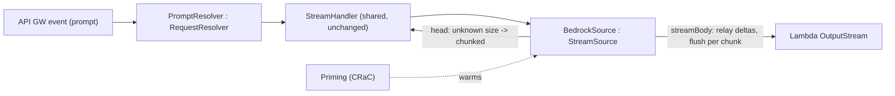

# Design Document

## Overview

This design governs an investigation-first effort whose primary deliverable is **evidence**: a measured answer to whether Amazon Bedrock (Nova Lite) token streaming arrives progressively through an API Gateway REST endpoint fronting a Kotlin/JVM `RequestStreamHandler` Lambda, or in a single terminal burst. Everything else in the plan is conditional on, or sequenced after, that answer.

The repository already ships a working streaming library (`streaming-core`) and a complete S3 example (`streaming-s3-example`). This effort reuses those assets rather than reinventing them: the throwaway Bedrock handler writes the API Gateway streaming wire format with the library's `ResponseWriter`, and the conditional production module mirrors the S3 example's `RequestResolver` / `StreamHandler` / `StreamSource` / `Priming` structure.

The design is deliberately staged so cost and blast radius stay minimal:

1. **Throwaway POC** — a minimal standalone handler and a copied SAM stack (`bedrock-stream-exp`), measured then deleted.
2. **40s timeout proof** — a throwaway long-running stream that outlives the API Gateway integration timeout.
3. **Conditional module** — only on a progressive verdict plus user greenlight.
4. **Documentation** — GIFs and README, last, each GIF behind a manual review gate.

The deployed `s3-file-streaming-endpoint` stack and its handler are treated as immutable. All throwaway artifacts are removed. Bedrock calls are gated behind explicit user confirmation. No secrets are written to recordings, logs, or the repo.

### Design Goals (traceability to requirements)

- Capture the plan as spec docs before any change (Req 1).
- Confirm Nova Lite + scope IAM with zero paid calls (Req 2).
- Relay Bedrock deltas with per-token flush via the library writer (Req 3).
- Deploy an isolated, standards-compliant throwaway stack (Req 4).
- Measure cadence only after cost confirmation (Req 5), report and log the verdict (Req 6).
- Tear the experiment down completely (Req 7).
- Source timeout figures from AWS docs (Req 8) and prove a >40s stream clears the integration timeout (Req 9).
- Build the production module only on a progressive verdict + greenlight (Req 10).
- Produce documentation last, behind GIF review gates (Req 11).

### Key Design Decisions

| Decision | Rationale | Requirements |
|---|---|---|
| Minimal standalone `RequestStreamHandler` for the POC (no `StreamSource`) | Fastest to build and throw away; the measurement needs only "relay deltas, flush each," not the full abstraction. | 3 |
| Reuse `streaming-core` `ResponseWriter.writeMetadata` | The wire protocol (metadata JSON + 8 null bytes) is already correct and tested; the POC should not re-implement it. | 3 |
| Separate SAM stack `bedrock-stream-exp` copied from the S3 template | Guarantees the real example stack/function is never modified; clean single-command teardown. | 4, 7 |
| Kotlin AWS SDK `aws.sdk.kotlin:bedrockruntime` at the catalog `awsSdkKotlin` version | Project standard is the Kotlin SDK, not the Java SDK; `InvokeModelWithResponseStream` returns a coroutine `Flow` of events. | 3 |
| Nova Lite via inference-profile id | Cheapest suitable model; inference profile is the correct eu-west-1 addressing for Nova. | 2, 5 |
| Explicit cost gate before first invocation | Bedrock costs money; the user owns that decision. | 5 |
| Python per-chunk reader mirroring `pipeline-streaming-test.sh` | Reuses the repo's proven measurement style; elapsed-ms-per-chunk is what distinguishes progressive from burst. | 5, 9 |
| 40s proof on a throwaway resource, real stack untouched | Proves the integration-timeout claim empirically without risking the production example. | 9 |
| Conditional module mirrors `streaming-s3-example` exactly | Consistency; `BedrockSource` slots into the existing `StreamHandler` orchestration unchanged. | 10 |
| GIF review gates before README wiring | The user must see each GIF before it is published; recordings are the one place a secret could leak. | 11 |

## Architecture

### System Context (POC)

```mermaid
flowchart LR
    client["curl -N (client)\nper-chunk ms reader"] -->|GET/POST x-api-key| apigw["API Gateway REST\nRESPONSE_STREAM\n/exp/bedrock-stream"]
    apigw --> lambda["Exp_Handler\nRequestStreamHandler (throwaway)"]
    lambda -->|writeMetadata + 8 null bytes| client
    lambda -->|InvokeModelWithResponseStream| bedrock["Bedrock Nova Lite\n(eu-west-1 inference profile)"]
    bedrock -->|text deltas Flow| lambda
    lambda -->|write(delta); flush() per token| client
```

### Exp_Handler flow

1. Read the prompt from the request body (API Gateway proxy event or raw body; the POC keeps parsing minimal).
2. Open the Bedrock Runtime client (Kotlin SDK), issue `InvokeModelWithResponseStream` for Nova Lite with the prompt.
3. Call `ResponseWriter().writeMetadata(output, ResponseMetadata(statusCode = 200, headers = {"Content-Type": "text/plain; charset=utf-8"}))` once — status committed here.
4. Collect the response event `Flow`; for each `chunk`/`contentBlockDelta` carrying text, decode the delta, `output.write(bytes)`, `output.flush()`, and log `{index, elapsedMs}` (no content).
5. On completion, optionally write a terminal sentinel, then close the stream.

Because API Gateway forwards flushed bytes based on write volume + invocation completion (established fact), the measurement reveals whether Bedrock's delta cadence produces enough continuous write volume to trickle through, or whether gaps cause buffering and a terminal burst.

### Cadence measurement

A real `curl --http1.1 -N -H "x-api-key: $KEY" "$EXP_URL/exp/bedrock-stream" -d '<prompt>'` is piped to a Python reader that timestamps each received chunk relative to the first byte. Reported metrics: first-byte ms, last-byte ms, first-to-last spread, count of distinct 100 ms arrival buckets, and wave count (>1 wave = progressive; 1 bucket at the end = terminal burst). One warmup invocation is discarded; 2–3 measured runs follow.

### 40s timeout proof

Two candidate mechanisms, chosen at execution time:

- **(a) Natural throttle** — exploit the documented 2 MB/s cap after the first 6 MB: stream an object large enough that server-side delivery exceeds 40s, on a throwaway copy of the S3 stack. Preferred when a single object cleanly exceeds 40s without approaching the idle timeout.
- **(b) Slow-drip handler** — a throwaway `RequestStreamHandler` that writes a chunk, sleeps a bounded interval (well under the idle timeout), and repeats for ~40s, deployed on a throwaway stack mirroring the example's Lambda standards.

Either way the deployed example is untouched, and the throwaway is deleted afterward. Success = `time_total >= 40s`, HTTP 200, full payload, TTFB << total, and chunks observed on both sides of the integration-timeout threshold.

### Conditional module architecture



`BedrockSource` adapts the `StreamSource` contract to a token stream: `head` returns an "exists, unknown size" result so `StreamHandler` writes metadata with `Transfer-Encoding: chunked` (rather than a `Content-Length`), and `streamBody` relays Bedrock deltas through the same per-chunk-flush path the S3 example uses. This lets the existing `StreamHandler` orchestration and `ResponseWriter` be reused without modification.

## Components and Interfaces

### Throwaway (deleted in teardown)
- `BedrockExpHandler` — standalone `RequestStreamHandler`; prompt parse + Bedrock relay + per-token flush + light logging.
- `BedrockExpPriming` — CRaC `Resource` warming the Bedrock client + handler path.
- `template-bedrock-exp.yaml` — SAM copy; stack `bedrock-stream-exp`, route `/exp/bedrock-stream`, scoped `bedrock:InvokeModelWithResponseStream` IAM.
- Python per-chunk reader + measurement scratch under `/tmp`.

### Conditional, production-grade (only on progressive verdict + greenlight)
- `streaming-bedrock-example` module: `PromptRequest`, `PromptResolver`, `BedrockSource`, `BedrockStreamingHandler`, `Priming`.
- `aws-sdk-kotlin-bedrockruntime` added to `gradle/libs.versions.toml`.
- `deployment/aws/sam-bedrock/` template + `build.sh`/`deploy.sh` mirroring the S3 example.
- `scripts/` opt-in, cost-guarded progressive-arrival post-deploy test.

### Reused unchanged
- `streaming-core`: `ResponseWriter`, `ResponseMetadata`, `copy()`, delimiter constants.
- `streaming-s3-example`: `StreamHandler`, `RequestResolver`, `StreamSource`, `Priming` as the structural template.

## Error Handling

- Prompt parse failure or empty prompt → `ResponseWriter.writeError(output, 400, ...)` before any body (status not yet committed).
- Bedrock invocation failure before first delta → `writeError(output, 502, ...)`.
- Failure after the first delta (status committed) → log at ERROR with the exception, truncate the body, propagate; never attempt to rewrite the status.
- All logging uses kotlin-logging structured lambdas with the exception passed (`logger.error(e) { ... }`), never model content or secrets.

## Testing Strategy

- **POC**: a MockK-based unit test of `BedrockExpHandler` asserting metadata is written exactly once before any body byte, each mocked delta is written and flushed in order, and the stream closes cleanly. Builds run with `--no-build-cache`.
- **40s proof**: empirical, against the throwaway deployment; asserted via curl timing + the Python per-chunk reader.
- **Conditional module**: unit + property tests (`@ParameterizedTest`, 10–20 cases) over universal properties (e.g. "every delta reaches the sink in order", "metadata precedes body", "memory stays bounded"), MockK relaxed property-level mocks reset with `clearMocks`, given-when-then backtick names, ≥80% Kover. Plus the opt-in post-deploy progressive-arrival script.

## Security and Cost

- Least privilege: the throwaway role gets only `bedrock:InvokeModelWithResponseStream` scoped to the Nova resource; the production module role mirrors that.
- API-key auth on every endpoint; the key value and execute-api host are never printed, recorded, or committed (masked in CI with `::add-mask::`).
- Bedrock spend bounded: warmup + 2–3 runs for the POC; the production post-deploy test is opt-in behind an `*_ENABLED` flag.
- Mandatory teardown returns the account to its prior state regardless of outcome.
