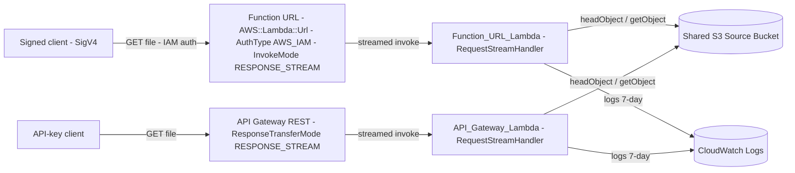
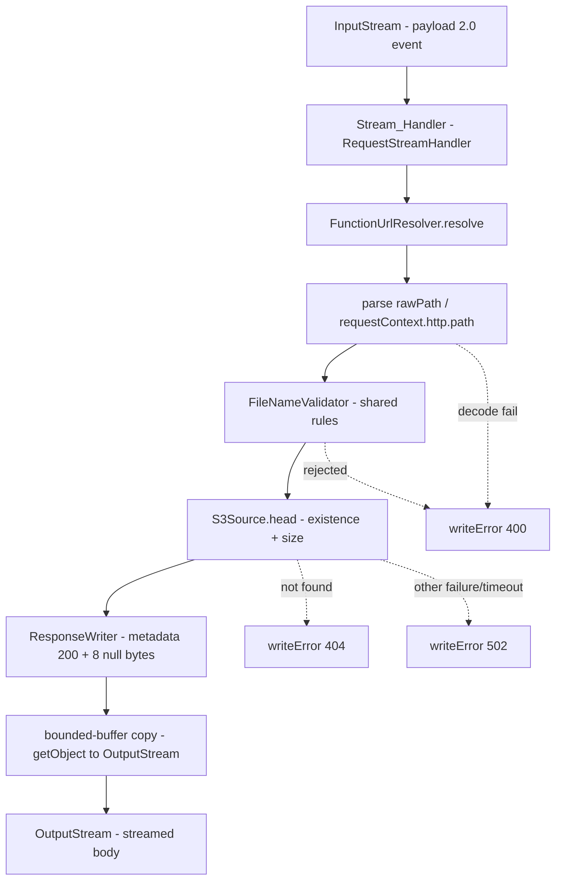
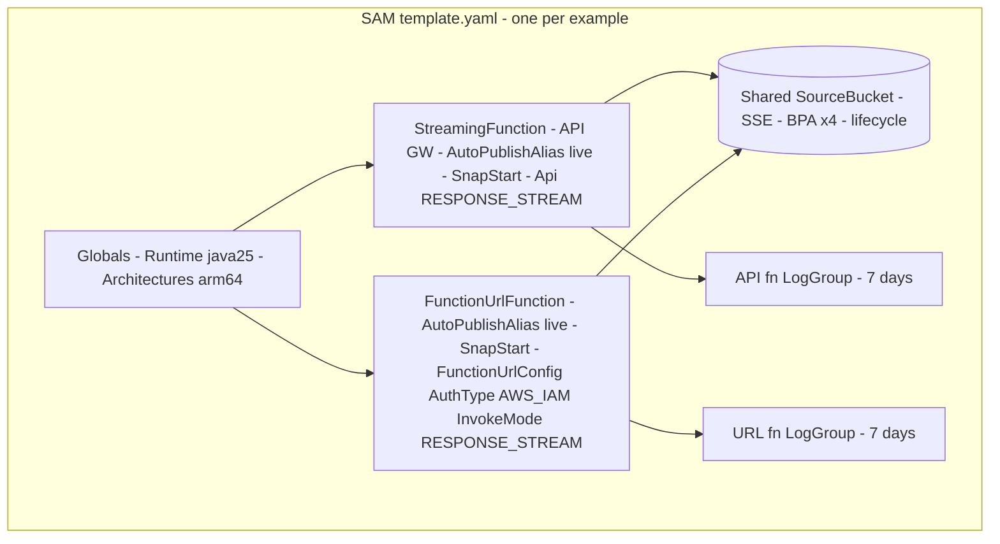

# Design Document

## Overview

This feature adds a second streaming invocation path — an **AWS Lambda Function URL** — alongside the existing API Gateway REST endpoint, in both example modules (Kotlin `streaming-s3-example`, Java `streaming-s3-example-java`), and proves it end to end against a deployed stack. The streaming wire protocol is unchanged: the `aws-lambda-streaming-core` `ResponseWriter` writes a metadata JSON document, 8 null bytes, then the body, regardless of what invoked the function. Only two things differ between the API Gateway path and the Function URL path:

1. **The event shape.** API Gateway delivers a REST proxy event (`pathParameters.proxy`); a Function URL delivers a Lambda **payload format 2.0** event (`rawPath`, `requestContext.http`, and — under IAM auth — `requestContext.authorizer.iam`).
2. **The deployment resource and its streaming knob.** API Gateway uses the SAM `Api` event with `ResponseTransferMode: RESPONSE_STREAM`; a Function URL uses a `FunctionUrlConfig` (→ `AWS::Lambda::Url`) with `InvokeMode: RESPONSE_STREAM` and `AuthType: AWS_IAM`.

The design gives each example a **dedicated Function URL Lambda**, distinct from its API Gateway Lambda, so the two invocation paths are configured, tested, and contrasted independently (Req 1). The Function URL Lambda reuses the same `streaming-core`, `S3Source`, bounded-buffer copy, SnapStart + CRaC priming, and cold-start settings as the API Gateway Lambda; only the request-resolution and the deployment resource are new.

The Kotlin example already has the abstraction that makes this cheap: `StreamHandler<R>` is generic over the request type and is injected with a `RequestResolver<R>` and a `StreamSource<R>`. The Java example has **no** resolver abstraction — its handler wires `RequestParser` → `FileNameValidator` inline — so this feature introduces an equivalent resolver layer in Java first, refactors the existing Java handler onto it without behavior change, then adds the Function URL resolver and handler (Req 3).

Proof is layered the same way as the API Gateway path: unit tests on the new resolver, Floci integration tests on the handler (fed an IAM-shaped Function URL event), and a post-deploy script run in the pipeline that signs its requests with SigV4 and verifies >6 MB delivery plus early first-byte timing (Req 4, 5, 9). The real IAM gate and progressive delivery over the wire can only be proven after deploy — no local emulator implements the Function URL streaming invocation path or its request signing — so that proof lives in the pipeline. The `InvokeMode` vs `ResponseTransferMode` distinction and any other gotcha are recorded in `docs/log.md` (Req 11).

### Design Goals (traceability to requirements)

- A separate Function URL Lambda per example, reusing all shared streaming/cold-start machinery (Req 1, Req 8, Req 10).
- Parse and resolve the Function URL payload-2.0 event, reusing the existing file-name validation (Req 2).
- Introduce a resolver abstraction in the Java example and refactor the existing handler onto it with no behavior change (Req 3).
- Unit-test the Function URL resolver in both languages (Req 4); Floci-integration-test the handler against an IAM-shaped event in both (Req 5).
- Configure the Function URL for `InvokeMode: RESPONSE_STREAM` and `AuthType: AWS_IAM`, with a stack output and `sam validate` gate (Req 6, Req 7).
- Prove the Function URL end to end in the pipeline with SigV4-signed requests, in addition to the existing API Gateway proof (Req 9).
- Document the Function URL path in the README and capture gotchas in `docs/log.md` (Req 11).

### Key Design Decisions

| Decision | Rationale | Requirements |
|---|---|---|
| Separate Function URL Lambda (second `AWS::Serverless::Function`), not a dual-mode handler | Different event shapes; two thin handlers over shared collaborators is cleaner than event-shape sniffing. The resolver abstraction makes the second handler nearly free. | 1 |
| Same stack per example (add to existing `template.yaml` / `sam-java/template.yaml`) — **Open Decision D1** | One `sam deploy`, shared OIDC role and source bucket, minimal pipeline change. | 6, 10 |
| `AuthType: AWS_IAM` + SigV4 in the post-deploy script — **Decided D2** | Function URL is not public; every caller is an authenticated, authorized principal. | 7, 9 |
| `InvokeMode: RESPONSE_STREAM` on the Function URL | The Function URL equivalent of API Gateway's `RESPONSE_STREAM`; `BUFFERED` would defeat streaming. Named-but-not-interchangeable with `ResponseTransferMode` — the headline gotcha. | 6, 11 |
| Kotlin: new `FunctionUrlResolver : RequestResolver<FileRequest>` + thin `S3FunctionUrlHandler`, reusing generic `StreamHandler<R>` and `S3Source` | `StreamHandler<R>` is already generic; the only new code is event parsing. | 1, 2 |
| Java: introduce `RequestResolver`/`RequestResult` + `FileKeyResolver` + `FunctionUrlResolver`, refactor existing handler onto them | Brings Java to structural parity with Kotlin and separates the two paths; existing behavior preserved by the existing test suite. | 3 |
| Parse the payload-2.0 event with the module's existing JSON reader (kotlinx-serialization lenient `Json` in Kotlin, lenient Jackson in Java) | Reuse each module's established parsing approach; read only the fields needed. | 2 |
| Reuse the existing source bucket, role shape, lifecycle, encryption, and log-retention pattern for the new function | Do not weaken or duplicate infrastructure; least privilege per function. | 10 |
| Extend `post-deploy-test.sh` to resolve and verify the Function URL (signed), keeping the API Gateway checks | Prove both paths every deploy; one script, two endpoints. | 9 |

## Architecture

### System Context



Two Lambdas in one stack per example share the source bucket. The Function URL Lambda is reached only by SigV4-signed callers (IAM); the API Gateway Lambda is reached via an API key as today. Both stream the same way to S3 and both can only `s3:GetObject` on the one bucket.

### Internal Component Flow (both languages, Function URL path)



The flow is identical to the API Gateway path from `FileNameValidator` onward — the only new node is `FunctionUrlResolver` and its `rawPath` extraction. Status-committed-early ordering is unchanged: existence/size is confirmed before any metadata is written; after commit a failure can only truncate the body (Req 2.5, 2.6).

### Kotlin wiring (minimal delta)

`StreamHandler<R>` is already generic and injected with a `RequestResolver<R>` and `StreamSource<R>`. The existing API Gateway entry point is:

```kotlin
class S3StreamingHandler : RequestStreamHandler {
    private val handler = StreamHandler(requestResolver = ::FileKeyResolver, source = ::S3Source)
    override fun handleRequest(input, output, context) = handler.handleRequest(input, output, context)
}
```

The Function URL path adds **one resolver and one entry point**, reusing the same `StreamHandler<FileRequest>` and `S3Source`:

```kotlin
class S3FunctionUrlHandler : RequestStreamHandler {
    private val handler = StreamHandler(requestResolver = ::FunctionUrlResolver, source = ::S3Source)
    override fun handleRequest(input, output, context) = handler.handleRequest(input, output, context)
}
```

No change to `StreamHandler`, `S3Source`, `FileNameValidator`, `ResponseWriter`, or `FileRequest`.

### Java wiring (new resolver layer + refactor)

Java has no resolver abstraction today; `StreamHandler.java` calls `parser.parse` then `validator.validate` inline. This feature:

1. Adds `RequestResolver<R>` (a functional interface) and a `RequestResult<R>` sealed type (`Resolved` / `Error`), mirroring the Kotlin contract.
2. Adds `FileKeyResolver` (API Gateway proxy path) and `FunctionUrlResolver` (payload-2.0 `rawPath`), both producing `FileRequest` and both reusing the existing `RequestParser`/`FileNameValidator` logic.
3. Refactors the existing `StreamHandler.java` so its parse+validate steps run through `FileKeyResolver` — externally observable behavior is unchanged and the existing test suite is the guard (Req 3.3).
4. Adds a thin `S3FunctionUrlHandler` entry point wired with `FunctionUrlResolver`.

### Deployment / Infrastructure Architecture (per example, same stack)



The new `FunctionUrlFunction` mirrors `StreamingFunction` (same `Globals`-inherited runtime/arch, SnapStart `live` alias, `JAVA_TOOL_OPTIONS` L1 tiered compilation, scoped `s3:GetObject` policy, bounded memory/timeout, its own 7-day log group), differing only in: `Handler` (the new `S3FunctionUrlHandler` / Java `nl.vintik.streaming.java.S3FunctionUrlHandler`), no API `Events`, and a `FunctionUrlConfig`.

### Function URL configuration (SAM)

```yaml
  FunctionUrlFunction:
    Type: AWS::Serverless::Function
    Properties:
      FunctionName: s3-file-streaming-function-url        # java-… in the Java template
      Handler: nl.vintik.lambda.streaming.S3FunctionUrlHandler
      CodeUri: ../../../build/dist/streaming-endpoint.jar
      MemorySize: !Ref MemorySizeMb
      Timeout: !Ref TimeoutSeconds
      AutoPublishAlias: live
      SnapStart:
        ApplyOn: PublishedVersions
      Environment:
        Variables:
          JAVA_TOOL_OPTIONS: "-XX:+TieredCompilation -XX:TieredStopAtLevel=1"
          BUCKET_NAME: !Ref SourceBucket
      Policies:
        - Statement:
            - Sid: GetObjectFromSourceBucketOnly
              Effect: Allow
              Action: s3:GetObject
              Resource: !Sub "${SourceBucket.Arn}/*"
      FunctionUrlConfig:
        AuthType: AWS_IAM                 # Req 7.1 — not NONE
        InvokeMode: RESPONSE_STREAM       # Req 6.2 — not BUFFERED
```

SAM's `FunctionUrlConfig` on an aliased function (`AutoPublishAlias: live`) attaches the URL to the `live` alias, so it resolves to the SnapStart-enabled published version rather than `$LATEST` (Req 8.4). New outputs expose the resolved URL (Req 6.4):

```yaml
Outputs:
  FunctionUrl:
    Description: HTTPS Function URL (AWS_IAM auth, RESPONSE_STREAM). Append the file name.
    Value: !GetAtt FunctionUrlFunctionUrl.FunctionUrl
  FunctionUrlFunctionName:
    Value: !Ref FunctionUrlFunction
```

### IAM: who may invoke the Function URL

`AuthType: AWS_IAM` means the caller must sign requests and hold `lambda:InvokeFunctionUrl` on the function, with the request's auth type matching. The pipeline's deploy role (`StreamingExampleGitHubActionsRole`, assumed via OIDC) is the caller in CI, so it is granted (Req 7.3):

```json
{
  "Effect": "Allow",
  "Action": "lambda:InvokeFunctionUrl",
  "Resource": "arn:aws:lambda:<region>:<account>:function:s3-file-streaming-function-url",
  "Condition": { "StringEquals": { "lambda:FunctionUrlAuthType": "AWS_IAM" } }
}
```

This statement is added to the OIDC role in `deployment/aws/oidc/github-oidc-role.yaml`, scoped to the specific function ARNs (Kotlin and Java), never a wildcard resource.

## Components and Interfaces

### Kotlin: FunctionUrlResolver (new)

```kotlin
class FunctionUrlResolver(
    private val validator: FileNameValidator = FileNameValidator(),
    private val json: Json = LenientJson,
) : RequestResolver<FileRequest> {
    override fun resolve(input: InputStream): RequestResult<FileRequest>
}
```

- Decodes a minimal lenient projection of the payload-2.0 event: `rawPath` and `requestContext.http.path`, ignoring everything else (`ignoreUnknownKeys = true`).
- Lifts the requested file name from the path (strips a leading `/`; takes the last segment to mirror the proxy semantics), then runs the **shared** `FileNameValidator`.
- Returns `RequestResult.Error(400, …)` on decode failure, `RequestResult.Error(400, …)` on validation rejection (no S3 request issued), `RequestResult.Resolved(FileRequest(name))` on success — identical status mapping to `FileKeyResolver`.

### Kotlin: S3FunctionUrlHandler (new entry point)

Thin `RequestStreamHandler` wiring `StreamHandler(requestResolver = ::FunctionUrlResolver, source = ::S3Source)`. No logic of its own.

### Java: RequestResolver / RequestResult (new abstraction)

```java
@FunctionalInterface
public interface RequestResolver<R> {
    RequestResult<R> resolve(InputStream input);
}

public sealed interface RequestResult<R> permits RequestResult.Resolved, RequestResult.Error {
    record Resolved<R>(R request) implements RequestResult<R> {}
    record Error<R>(int statusCode, String message) implements RequestResult<R> {}
}
```

### Java: FileKeyResolver (new) and FunctionUrlResolver (new)

- `FileKeyResolver` wraps the existing `RequestParser` + `FileNameValidator`, producing `FileRequest`; the refactored `StreamHandler.java` delegates to it so behavior is unchanged (Req 3.3).
- `FunctionUrlResolver` parses the payload-2.0 `rawPath` with the lenient Jackson `ObjectMapper` already used in `RequestParser`, then validates with the shared `FileNameValidator`.

### Java: S3FunctionUrlHandler (new entry point)

A `RequestStreamHandler` wired with `FunctionUrlResolver`, driving the same `S3Source` + library `ResponseWriter` the existing handler uses. Registers `Priming` (Req 8.2).

### Shared / unchanged

`FileNameValidator`, `S3Source`, `ResponseWriter`/`ResponseMetadata` (core), `FileRequest`, and the bounded-buffer `copy` are reused as-is in both languages. The API Gateway handlers and endpoints are untouched behaviorally (Req 1.4).

### Priming (both languages)

The Function URL Lambda registers a `Priming` hook whose `beforeCheckpoint` exercises S3 client init, one handler invocation against a **primed payload-2.0 Function URL event**, and metadata serialization (Req 8.2). This is the existing priming pattern with a Function-URL-shaped primed event instead of a proxy event.

## Data Models

### Function URL event projection (parsed input, payload format 2.0)

Only the fields needed to locate the file are read; the rest (including `requestContext.authorizer.iam`, present under IAM auth) are tolerated and ignored.

Kotlin:
```kotlin
@Serializable
private data class FunctionUrlEvent(
    val rawPath: String? = null,
    val requestContext: RequestContext? = null,
) {
    @Serializable data class RequestContext(val http: Http? = null)
    @Serializable data class Http(val path: String? = null)
    fun requestedPath(): String = (rawPath ?: requestContext?.http?.path).orEmpty()
}
```

The file name is `requestedPath().trimStart('/').substringAfterLast('/')` (empty when absent — left for the validator to reject, matching the proxy path's empty-string behavior).

### Reused models

`FileRequest(fileName)`, `ValidationResult` (`Valid`/`Invalid(reason)`), `HeadResult` (`Exists(size)`/`NotFound`/`Failure`), `ResponseMetadata(statusCode, headers, cookies?)`, and `RequestResult` (`Resolved`/`Error`) are unchanged in Kotlin and introduced to match in Java (`RequestResult` only; the rest already exist in the Java module).

## Correctness Properties

Each property is universally quantified and implemented by a single `@ParameterizedTest` (`@ValueSource`/`@MethodSource`), 10–20 diverse cases, per `tech.md`. The Function URL path reuses the shared validator, serializer, and copy logic already covered by the existing property suites; the new properties below target the Function-URL-specific resolution and the IAM/pipeline proof.

### Property 1: Function URL path extraction yields the same file name as the proxy path for equivalent requests

*For all* file names `n` in the valid set, a payload-2.0 event whose `rawPath` is `"/" + n` (and the equivalent `requestContext.http.path`) resolves, via `FunctionUrlResolver`, to `RequestResult.Resolved(FileRequest(n))` — the same `FileRequest` the API Gateway `FileKeyResolver` produces for `pathParameters.proxy = n`. Covered for both languages.

Input space: valid names across the allow-list and boundary lengths, each rendered as a payload-2.0 event; the resolver output is compared to the proxy resolver's output for the same name.

**Validates: Requirements 2.1, 2.3, 4.1**

### Property 2: Function URL resolver rejects exactly the unsafe set and issues no S3 request

*For all* strings `s`, `FunctionUrlResolver` returns `RequestResult.Error(400, …)` **if and only if** the extracted file name is rejected by the shared `FileNameValidator` (allow-list, separators, `..`, absolute prefixes, empty/whitespace, length > 1024) or the event cannot be decoded; and for every rejected input the handler writes 400 and the mocked `S3Source` receives **zero** calls. Covered for both languages.

Input space: a mix of valid payload-2.0 events, events with adversarial paths (`..`, `/`, `\`, illegal chars, over-length), empty/absent `rawPath`, and malformed JSON. Asserted against the shared validator as the reference predicate, with a relaxed `S3Source` mock verified to have no interactions on every rejection.

**Validates: Requirements 2.2, 2.4, 4.1, 4.3**

### Property 3: Streaming output over the Function URL path is byte-identical to the source

*For all* object sizes `n` (0, sub-6 MB, ~6 MB, ~15 MB, non-aligned), invoking the Function URL handler with a payload-2.0 event for an object of size `n` produces a response whose body is byte-identical to the stored S3 object (same bytes, order, count). Exercised by the Floci integration tests in both languages against an IAM-shaped event.

Input space: sub-6 MB and ≥15 MB objects seeded into the emulated S3; the handler is invoked directly with an `AWS_IAM`-authorized payload-2.0 event (local emulators do not implement the signed Function URL invocation path, per `tech.md`).

**Validates: Requirements 5.1, 5.2, 5.3**

## Error Handling

The status-committed-early rule is unchanged and inherited from the shared `StreamHandler` / library `ResponseWriter`. The Function-URL-specific additions:

| Failure | Committed status | Body guarantee | Component | Requirements |
|---|---|---|---|---|
| Payload-2.0 event cannot be decoded | 400 | No body; JSON error | `FunctionUrlResolver` → handler | 2.2 |
| Extracted file name rejected by shared validator | 400 | No body; **no S3 request** | `FunctionUrlResolver` → handler | 2.4 |
| S3 object absent | 404 | No body | `S3Source.head` → handler | 2.5 |
| `headObject` non-missing failure / timeout | 502 | No body | `S3Source.head` → handler | 2.5 |
| Read/write failure mid-stream after 200 commit | unchanged (200) | Body **truncated**, no retroactive 502 | `S3Source.streamBody` | 2.6 |
| Unsigned / badly-signed request to the Function URL (deployed) | 403 | No content served | AWS Function URL IAM layer (not handler code) | 7.5 |

IAM authentication (403 on unsigned requests) is enforced by the Function URL platform layer, not by handler code — the handler is only ever invoked after IAM has authorized the caller. This is why the IAM gate is proven only in the pipeline (signed vs. the absence of signing), not in unit/integration tests.

## Pipeline and Post-Deploy Verification

### SigV4 signing in the post-deploy script

`scripts/post-deploy-test.sh` currently resolves `StreamingEndpointUrl` and an API key, then issues `curl` requests with an `x-api-key` header. The Function URL path is added as a parallel verification:

- Resolve the new `FunctionUrl` stack output (Req 6.4, 9.1).
- Issue **SigV4-signed** GETs to the Function URL. `curl` supports this natively via `--aws-sigv4 "aws:amz:<region>:lambda"` with `--user "$AWS_ACCESS_KEY_ID:$AWS_SECRET_ACCESS_KEY"` and, for the OIDC session, `-H "x-amz-security-token: $AWS_SESSION_TOKEN"`. These come from the pipeline's assumed-role credentials already present in the job environment (Req 7.4, 9.2). The script asserts signed requests are always used and never falls back to unsigned.
- Reuse the existing checks against the Function URL body: full ≥15 MB delivery and byte-identical content (Req 9.3), and a single post-warmup first-byte-within-50%-of-total measurement (Req 9.4, per the clarified single-measurement rule). The memory check from the API Gateway path is retained for that path; it is optional for the Function URL path (same Lambda shape, bounded buffer).
- A 403, unreachable endpoint, or any non-2xx on the Function URL is a hard non-zero exit (Req 9.5); a size/content mismatch likewise (Req 9.6).
- The Function URL verification runs **in addition to** the existing API Gateway verification (Req 9.7).

### Workflow changes

- `workflow-deploy-aws.yml` → `Get deployment outputs` additionally reads `FunctionUrl` and exposes it as a job output.
- `workflow-streaming-test.yml` / the pipeline script receives the Function URL (via env or stack lookup) and runs the signed Function URL checks for both the Kotlin and Java stacks. The job already assumes the OIDC role, so SigV4 credentials are available; the role now also carries `lambda:InvokeFunctionUrl` (Req 7.3).

### Manual invocation (docs)

The README / `docs/log.md` documents the signed-invocation recipe so the IAM requirement is reproducible outside CI (Req 7.6), e.g. `curl --aws-sigv4 "aws:amz:<region>:lambda" --user "$AK:$SK" -H "x-amz-security-token: $ST" "<FunctionUrl><file>"` or `awscurl --service lambda`.

## Documentation and Knowledge Capture

- **README** (Req 11.1): the existing Function-URL paragraph is updated from "supported at the protocol level" to "proven end to end by the pipeline for both the Kotlin and Java examples", plus a signed-`curl` example and a note that the Function URL uses `AuthType: AWS_IAM`.
- **`docs/log.md`** (Req 11.2, 11.3): record the `InvokeMode: RESPONSE_STREAM` (Function URL) vs `ResponseTransferMode: RESPONSE_STREAM` (API Gateway SAM) distinction as a named gotcha, and append any further hiccup within the same session (the obligation is independent of session timing per Req 11.3). No runtime secrets; identifiers by placeholder (Req 11.4).

## Testing Strategy

Layered, mirroring the API Gateway path and `tech.md`:

- **Unit** (Req 4): `FunctionUrlResolver` tests in both languages — empty input → 400, malformed JSON → 400, well-formed payload-2.0 event with a rejected name → 400, well-formed event with an accepted name → `Resolved(FileRequest(name))`. Plus the Java `RequestResolver`/`FileKeyResolver` tests and confirmation the refactored Java API Gateway handler keeps its existing tests green (Req 3.3, 3.4). Property tests 1–2 above.
- **Integration (Floci)** (Req 5): per module, a sub-6 MB and a ≥15 MB streaming test that invokes the Function URL handler with an `AWS_IAM`-shaped payload-2.0 event (`requestContext.authorizer.iam` present) and asserts byte-identical delivery, extending the module's existing `FlociS3IntegrationTestBase`, one container per class, data cleaned between tests. Property test 3 above. IAM signing and progressive delivery over the wire are explicitly deferred to the pipeline (Req 5.5).
- **Post-deploy (pipeline, real AWS)** (Req 9): signed Function URL checks as described above, for both stacks, alongside the existing API Gateway checks.
- **Coverage**: ≥ 90% (`koverVerify`) maintained; new resolvers and the Java resolver layer are pure/mockable and fully unit-covered.
- **SAM validation** (Req 6.5): `sam validate --template-file <changed template>` must exit 0 before committing each changed template.
