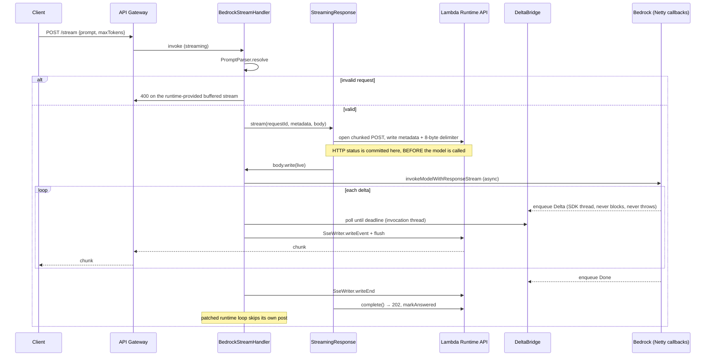

# Design Document

## Overview

This feature adds `streaming-bedrock-example-java`, a Java counterpart to the Kotlin `streaming-bedrock-example`, and makes `aws-lambda-streaming-sse` pleasant to call from plain Java. A single Java Lambda on the managed `java25` runtime, behind an API Gateway REST proxy integration, relays Amazon Bedrock Nova Lite token deltas to the client as Server-Sent Events, token by token.

Progressive delivery comes from the existing library mechanism and is not reimplemented: `StreamingResponse` posts the invocation response to the Lambda Runtime API itself as a chunked request, and the function's own fat jar doubles as a `-javaagent` that stops AWS's invocation loop from posting a second response. This example proves that the mechanism is not Kotlin-specific, on a deployed endpoint.

Two measured findings frame the work, both established before this design was written:

- **`streaming-sse` 3.0.0 already works from plain Java.** A scratch probe compiled and ran against the published module: `SseWriter`, `ResponseChannelFactory` (a `fun interface`, so a Java lambda satisfies it), an anonymous `ResponseChannel`, `new StreamingResponse(...)`, `StreamingAgent.isPatched()` and `send(...)` with a Java lambda. `kotlin-stdlib` reaches a Java consumer's compile classpath transitively through `streaming-core`. No library change is needed for Java to function; the library changes below remove two frictions.
- **The AWS SDK for Java v2 exposes Bedrock response streaming only on the asynchronous client.** The Javadoc method list for `BedrockRuntimeClient` has no `invokeModelWithResponseStream` and no `converseStream`; `BedrockRuntimeAsyncClient` has both. The Kotlin example collects a coroutine `Flow` on the invocation thread. The Java example must bridge SDK callback threads onto the invocation thread. That bridge is the substantive part of the port.

### Design Goals (traceability to requirements)

| Goal | Requirements |
|---|---|
| Java consumption of the SSE library proven by a deployed example | 1, 11 |
| Java-friendly library entry points, additive and source-compatible | 2, 14 |
| Strict prompt handling, explicit about what it rejects | 3 |
| Correct async-to-invocation-thread bridging, with a deadline | 4 |
| An honest status-ordering contract | 5 |
| Packaging that makes the agent load, and fails the build when it cannot | 6 |
| Cold-start parity with the other examples, including a priming hook that is actually registered | 7 |
| Streaming API Gateway configuration, scoped IAM, bounded cost | 8, 9, 10 |
| Tested in layers, coverage registered everywhere it must be | 12 |
| Wired into CI on the same terms as the other examples | 13 |
| Documented, with demo assets that match the implementation | 15, 16 |

### Key Design Decisions

These resolve the open questions left in the requirements.

| # | Decision | Rationale |
|---|---|---|
| D1 | Add `StreamingResponse.stream(requestId, metadata, ResponseBody)` and a `fun interface ResponseBody { @Throws(IOException::class) fun write(output: OutputStream) }`, rather than overloading `send`. | A `Consumer<OutputStream>` overload of `send` risks Kotlin overload ambiguity for existing trailing-lambda callers, which would threaten source compatibility (Req 2.3, 2.8). A different method name cannot collide. A dedicated interface can declare `throws IOException`, which `Consumer` cannot, and writing to an `OutputStream` throws it. No `return null;` standing in for `Unit`. |
| D2 | Add `@JvmOverloads` to `ResponseMetadata`'s primary constructor. | Java then gets `ResponseMetadata(int, Map)`. Kotlin call sites are unchanged. Only new constructors are added to the `.api` dump. If the `@Serializable` plugin objects, fall back to an explicit secondary constructor delegating with `null`. |
| D3 | The delta bridge is an unbounded `LinkedBlockingQueue` of signals. SDK callbacks only enqueue; the invocation thread drains and is the only writer. | The SDK swallows exceptions thrown inside a visitor (aws-sdk-java-v2 issue #4929), so the visitor must never throw or write. Blocking inside an SDK callback would stall Netty's event loop. A single writer keeps the non-thread-safe `HttpURLConnection` stream and the `ThreadLocal` `StreamingState` on one thread. The queue is bounded in practice by the token ceiling. |
| D4 | Netty NIO async HTTP client, declared explicitly and set on the client builder. | Decided in requirements review. |
| D5 | A separate stack, `deployment/aws/sam-bedrock-java/`, stack name `bedrock-streaming-endpoint-java`. | The S3 examples use separate stacks. Handler, `CodeUri`, agent jar path and log retention all differ, so a parameterised shared template would save little and couple two examples. |
| D6 | Java never writes a status after the stream opens. The Kotlin handler's unreachable 502 branch is handled by a measure-then-decide task (T13). | Measured behaviour of that path is unknown (see Error Handling). The decision rule is stated in advance so the outcome is not argued afterwards. |
| D7 | Parameter handling is strict: unsupported body parameters and non-JSON bodies are rejected with 400. | Decided in requirements review. Deliberately stricter than the Kotlin example, which ignores them; documented in both READMEs. |
| D8 | Model id comes from a `MODEL_ID` environment variable, set in the template from the same parameter that scopes IAM. | The Kotlin example hard-codes the id in source while IAM names it in the template, so the two can drift. One source for both. |
| D9 | Coverage uses JaCoCo, behind `koverVerify` / `koverHtmlReport` alias tasks. | Kover cannot instrument a pure-Java module. This follows `streaming-s3-example-java` exactly. |
| D10 | Library changes are additive, so the release is MINOR, via a `feat:` commit. | A `feat!:` would cut a major version for no reason. The release trigger already covers the library paths. |

## Architecture

### System Context

```
Client ──POST /stream──▶ API Gateway (REST, RESPONSE_STREAM, REGIONAL)
                              │  InvokeWithResponseStream
                              ▼
                  Lambda (java25, arm64, SnapStart, -javaagent)
                              │
        ┌─────────────────────┴──────────────────────┐
        │ BedrockStreamHandler (RequestStreamHandler) │
        └─────────────────────┬──────────────────────┘
                              │
   PromptParser ─▶ StreamingResponse.stream ─▶ Runtime API (chunked POST)
                              │
                       BedrockAsyncSource ─▶ BedrockRuntimeAsyncClient (Netty)
                              │                         │ SDK callback threads
                              └──── DeltaBridge ◀───────┘   (enqueue only)
```

### Request / Response Sequence



### Threading model

| Thread | Does | Never does |
|---|---|---|
| Invocation thread | parse, open the stream, drain the queue, write and flush SSE events, complete the response, mark answered | block on the SDK without a deadline |
| SDK / Netty callback threads | decode a chunk, enqueue a signal | write to the live stream, touch `StreamingState`, throw, block |

`StreamingState` is a `ThreadLocal`, set by `StreamingResponse` on the thread that called `stream`. Keeping the body on the invocation thread is what makes that flag correct, not just tidy.

## Library changes

Both changes are additive. Neither alters an existing Kotlin signature.

### `streaming-core`: `ResponseMetadata`

```kotlin
@Serializable
public data class ResponseMetadata @JvmOverloads constructor(
    public val statusCode: Int,
    public val headers: Map<String, String>,
    @EncodeDefault(EncodeDefault.Mode.NEVER)
    public val cookies: List<String>? = null,
)
```

Java: `new ResponseMetadata(200, headers)`. The generated default-argument synthetic constructor is unchanged, so binary compatibility holds. `apiDump` gains the two-argument constructor.

### `streaming-sse`: `ResponseBody` and `StreamingResponse.stream`

```kotlin
public fun interface ResponseBody {
    @Throws(IOException::class)
    public fun write(output: OutputStream)
}

// in StreamingResponse
@Throws(IOException::class)
public fun stream(requestId: String, metadata: ResponseMetadata, body: ResponseBody) {
    send(requestId, metadata) { out -> body.write(out) }
}
```

Java call site:

```java
streaming.stream(context.getAwsRequestId(), metadata, live -> {
    SseWriter sse = new SseWriter();
    source.stream(request, deadline, delta -> sse.writeEvent(live, delta));
    sse.writeEnd(live);
});
```

`stream` is a thin wrapper, so every guarantee of `send` (agent check, answered flag, completion on failure) applies unchanged. The compatibility gate (Req 2.3, 2.8) is enforced by `apiCheck` plus a Java test that fails the build if either entry point stops compiling from Java.

## Components and Interfaces

Package `nl.vintik.streaming.bedrock`, Java 25 toolchain, consuming the Java-21-compiled libraries.

### BedrockStreamHandler

`public final class BedrockStreamHandler implements RequestStreamHandler`. A public no-arg constructor wires production collaborators; a package-private constructor takes them for tests. The entry class holds `private static final Priming PRIMING = new Priming();` so class initialization registers the CRaC hook (Req 7.2).

```java
public void handleRequest(InputStream input, OutputStream output, Context context) throws IOException {
    PromptResult result = parser.resolve(input);
    if (result instanceof PromptResult.Rejected rejected) {
        // Nothing is committed yet: answer on the runtime's own buffered stream.
        writer.writeError(output, rejected.status(), rejected.message());
        return;
    }
    PromptRequest request = ((PromptResult.Resolved) result).request();
    Deadline deadline = Deadline.fromContext(context);
    streaming.stream(context.getAwsRequestId(), SSE_METADATA, live -> relay(request, deadline, live));
}
```

`relay` writes each delta as an SSE event and the terminal event on success. On any failure it logs at WARN or above, makes a best-effort attempt to write a named SSE `error` event (message carries no model or prompt detail), then rethrows so the invocation is reported failed (Req 4.5, 4.10, 4.11, 5.4). There is no branch that attempts a different status after the stream opens (Req 5.3).

Response metadata: status 200, `Content-Type: text/event-stream; charset=utf-8`, `Cache-Control: no-cache`, `Transfer-Encoding: chunked`; no `Content-Length`.

### PromptParser

Reads the event from the `InputStream` with Jackson. A document with a `body` member is an API Gateway proxy event and its `body` string is the payload; a document without one is treated as the payload itself, which is what unit tests and local invocation use.

| Input | Result |
|---|---|
| no body, empty body, `body: null` | defaults |
| body present but not a JSON object | `Rejected(400, "The request body is not valid JSON.")` |
| a member other than `prompt` or `maxTokens` | `Rejected(400, "Unsupported parameter: <name>")`, name truncated to 64 characters, remaining members not processed |
| `prompt` not a string | `Rejected(400, "The prompt must be a string.")` |
| prompt blank | default prompt |
| prompt longer than 8,000 characters | `Rejected(400, "The prompt is too long.")` |
| `maxTokens` absent or non-numeric | default 1,000, then clamped |
| `maxTokens` outside `[1, 5000]` | clamped into range |

The error message is JSON-encoded by `ResponseWriter.writeError`, so a hostile parameter name cannot break the response. Only exception types are logged, never the payload.

### TokenStream, DeltaSink, Deadline

```java
@FunctionalInterface interface TokenStream { void stream(PromptRequest r, Deadline d, DeltaSink sink) throws IOException; }
@FunctionalInterface interface DeltaSink   { void accept(String text) throws IOException; }
```

`Deadline` is a small value class: `fromContext(context)` is `now + context.getRemainingTimeInMillis() − SAFETY_MARGIN` (3 s), with `remainingNanos()` and `isExpired()`. It exists so the drain loop and tests share one definition of "out of time".

### BedrockAsyncSource and DeltaBridge

`BedrockAsyncSource implements TokenStream`. It builds the Nova "messages-v1" body, calls `invokeModelWithResponseStream`, and hands every signal to a `DeltaBridge`:

```java
BedrockRuntimeAsyncClient client = BedrockRuntimeAsyncClient.builder()
    .httpClientBuilder(NettyNioAsyncHttpClient.builder().readTimeout(Duration.ofSeconds(60)))
    .build();

var visitor = InvokeModelWithResponseStreamResponseHandler.Visitor.builder()
    .onChunk(part -> bridge.offerDelta(NovaPayload.textDelta(part.bytes().asUtf8String())))
    .build();
var handler = InvokeModelWithResponseStreamResponseHandler.builder()
    .subscriber(visitor)
    .onComplete(bridge::offerDone)
    .onError(bridge::offerFailure)
    .build();

CompletableFuture<Void> call = client.invokeModelWithResponseStream(request, handler);
call.whenComplete((v, t) -> { if (t != null) bridge.offerFailure(t); });
bridge.drain(deadline, sink, () -> call.cancel(true));
```

`DeltaBridge` internals:

```java
sealed interface Signal permits Delta, Done, Failed {}
record Delta(String text) implements Signal {}
record Done() implements Signal {}
record Failed(Throwable cause) implements Signal {}
```

`drain` loops on `queue.poll(remaining, NANOSECONDS)`:

| Polled | Action |
|---|---|
| `Delta` | `sink.accept(text)` on the invocation thread; the write failure, if any, propagates |
| `Done` | return normally |
| `Failed` | throw `ModelStreamException` with the cause |
| `null` (deadline) | run the cancel action, throw `ModelStreamTimeoutException` |
| `InterruptedException` | restore the interrupt flag, cancel, throw |

The first terminal signal wins; later signals are ignored. Success is signalled only from the handler's `onComplete`, not from the future. This avoids a race where the future completes before the last delta is enqueued. If `onComplete` were ever lost, the deadline turns the silence into an explicit timeout rather than a hang.

The visitor catches everything. A payload that cannot be parsed yields no delta and a WARN carrying only the exception type.

### NovaPayload

Pure functions, so they are property-testable:

- `requestBody(prompt, maxTokens)` builds the body with Jackson's `ObjectNode`, never string concatenation, so quotes, newlines and Unicode round-trip exactly.
- `textDelta(json)` returns the text of `contentBlockDelta.delta.text`, or `null` for events with none (`messageStart`, `contentBlockStop`, `metadata`). Never throws.

### StreamTimings

A small Java port of the Kotlin helper: INFO lines `timing requestId=… stage=… tMs=…` for `start`, `firstDelta`, `streamEnd` and `closed`. Requirement 8.5 promises server-side access-log timings can be joined to handler timing lines through `$context.integration.requestId`, so these lines have to exist. The prompt and model id are never logged.

### Priming (CRaC)

Registers itself with the global CRaC context in its constructor. `beforeCheckpoint` exercises, once each: construct and close a `BedrockRuntimeAsyncClient` (which loads and warms Netty), parse a primed event through `PromptParser`, encode one SSE event, and serialize response metadata through `ResponseWriter`. It does not call the model and does not attempt the Runtime API transport, which needs a real invocation id. Errors propagate so snapshot creation fails. Collaborators are `Supplier`s passed through a package-private constructor, which is how the single-pass test counts invocations.

The production source creates its real client lazily on first invocation, after restore. Priming builds and closes a throwaway client rather than keeping one, so no credentials resolved at snapshot time are carried into restored invocations.

## Data Models

```java
record PromptRequest(String prompt, int maxTokens) {}

sealed interface PromptResult permits PromptResult.Resolved, PromptResult.Rejected {
    record Resolved(PromptRequest request) implements PromptResult {}
    record Rejected(int status, String message) implements PromptResult {}
}
```

Constants: `DEFAULT_PROMPT`, `DEFAULT_MAX_TOKENS = 1000`, `MAX_PROMPT_LEN = 8000`, `MAX_TOKENS_CEILING = 5000`, `SAFETY_MARGIN = 3 s`. `ModelStreamException` and `ModelStreamTimeoutException` are unchecked.

## Correctness Properties

Each becomes one `@ParameterizedTest` over 10 to 20 diverse cases, tagged `Feature: java-bedrock-sse-streaming-endpoint, Property N: …`.

### Property 1: SSE relay round-trips the model's text
For any sequence of deltas, including empty, multi-line and non-ASCII text, a conforming SSE client reassembles exactly the concatenated deltas from the bytes the handler wrote, followed by the terminal event. **Validates: Requirements 4.2, 4.4, 12.2**

### Property 2: Bytes on the wire stay proportional to the answer
For any delta sequence, bytes written never exceed the answer's size plus a fixed per-event overhead plus the terminal event. No padding-style inflation is possible. **Validates: Requirements 11.4, 12.2**

### Property 3: The Nova request body preserves the prompt exactly
For any prompt, the generated body parses as JSON and carries the identical prompt and token count. **Validates: Requirements 4.1**

### Property 4: The token count never exceeds the ceiling
For any requested `maxTokens` (negative, zero, huge, fractional, non-numeric, absent), the value passed to the model lies in `[1, MAX_TOKENS_CEILING]`. **Validates: Requirements 3.4, 10.3**

### Property 5: The bridge preserves order and terminal semantics
For random producers on separate threads, the consumer sees every delta in order, then exactly one terminal outcome. A failure yields the delivered prefix then an exception. A producer that never terminates yields a timeout no later than the deadline plus tolerance. **Validates: Requirements 4.2, 4.3, 4.5, 4.6, 4.10**

### Property 6: Unsupported parameters never reach the model
For any request carrying a member outside `{prompt, maxTokens}`, the result is a 400 naming that member and the model source has zero interactions. **Validates: Requirements 3.6**

### Property 7: Priming exercises every path exactly once
Across one `beforeCheckpoint`, each critical path is invoked exactly once; a path that throws propagates. **Validates: Requirements 7.3, 7.4, 7.8**

## Error Handling

"Failed" means the exception propagates out of `handleRequest`.

| Condition | Client sees | Invocation |
|---|---|---|
| Invalid request | 400 JSON, buffered | success |
| Agent not loaded (`isPatched()` false) | gateway error, nothing streamed | failed, message names the fix |
| Runtime API does not return 202 | truncated or empty | failed |
| Model fails before the first delta | 200, empty body, best-effort `error` event | failed |
| Model fails mid-stream | 200, truncated body, best-effort `error` event | failed |
| Deadline reached | 200, truncated body, best-effort `error` event | failed with `ModelStreamTimeoutException` |
| Thread interrupted | 200, truncated body | failed, interrupt flag preserved |
| Unparseable Nova event | that event skipped | unaffected |

The 200 is on the wire before the model is called, so none of the model-failure rows can produce another status. That is a property of `StreamingResponse.send`, which writes metadata and delimiter before running the body.

### Known unknown: what the runtime does after a failure

On a body failure `send` completes the channel (202) but does not mark the invocation answered, then rethrows. The runtime then reports the failure through `reportInvocationError`, which the agent does not patch, for a request the Runtime API has already accepted. Whether that is harmless, logs an error, or kills the execution environment (`Runtime.ExitError`) has not been measured. This design does not guess. T13 measures it on the existing Kotlin stack and the decision rule is fixed in advance:

- **Harmless or log-only:** remove the Kotlin handler's unreachable 502 branch so both examples share the rethrow path (Req 5.6).
- **Kills the environment:** keep the Kotlin branch but mark it unreachable with a comment citing the log entry, and open a follow-up spec to make the agent also guard `reportInvocationError`. Do not widen this spec to patch a second runtime method.

## Deployment / Infrastructure (SAM)

`deployment/aws/sam-bedrock-java/` contains `template.yaml`, `samconfig.toml`, `build.sh` and `deploy.sh`, mirroring `sam-bedrock/`. The template differs from the Kotlin one only here:

| Item | Value |
|---|---|
| Handler | `nl.vintik.streaming.bedrock.BedrockStreamHandler` |
| `CodeUri` | `../../../build/dist/bedrock-streaming-endpoint-java.zip` |
| `JAVA_TOOL_OPTIONS` | `-XX:+TieredCompilation -XX:TieredStopAtLevel=1 -javaagent:/var/task/lib/bedrock-streaming-endpoint-java.jar` |
| `MODEL_ID` env var | `!Ref NovaLiteProfileId` |
| `LogRetentionDays` | Min 14, Max 30, Default 14 |
| Function name | `bedrock-streaming-endpoint-java` |
| Usage plan | `BedrockJavaStreamingApiUsagePlan` |

Unchanged from the Kotlin template: `java25`/`arm64` from Globals, `AutoPublishAlias: live` with SnapStart on published versions, REGIONAL REST API, `ResponseTransferMode: RESPONSE_STREAM`, API-key auth, the access-log format with the three streaming timing fields and `integration.requestId`, and an IAM policy of `bedrock:InvokeModelWithResponseStream` only, on the inference profile and its regional foundation-model copies.

The deploy README states the account-level prerequisite for the access log: API Gateway's CloudWatch role, once per account and Region.

### IAM / OIDC (Req 13.4)

The CloudFormation execution role is already broad: `function:*`, `/*` for API Gateway, `logs:…:*`, and `iam` on `*`. The Kotlin Bedrock stack deploys under it with no Bedrock-specific entries, because the Bedrock permission lives in the function's own execution role, which SAM creates. The Bedrock test uses only CloudFormation, API Gateway and Lambda reads and no `logs:FilterLogEvents`. The expectation is that no OIDC change is needed. Requirement 13.4 says the roles "SHALL be extended", which overstates that. T12.4 verifies by deploying and extends the role only if a real gap appears; the requirement text should then be softened to match.

## CI/CD Design

Every registration point, found by reading the repository rather than assumed:

| File | Change | Req |
|---|---|---|
| `settings.gradle.kts` | `include("streaming-bedrock-example-java")` | 1 |
| `gradle/libs.versions.toml` | versionless `aws-sdk-java-bedrockruntime`, `aws-sdk-java-netty-nio` (BOM-managed) | 4.7, 4.8 |
| `build.gradle.kts` (root) | add the JaCoCo report to `validationReports` and `uploadReports` | 12.6, 12.9 |
| `.github/workflows/workflow-build.yml` | add the report to the eligibility loop and to `files:`; add `sam validate` for `sam-bedrock` and `sam-bedrock-java` | 12.6, 13.2 |
| `.github/workflows/workflow-deploy-aws.yml` | new `log-retention-days` input, default `7`; replace the hardcoded `LogRetentionDays=7` | 9.6, 13.5 |
| `cd-deploy-on-demand.yml`, `ci-feature-build.yml` | one deploy-matrix entry and one test-matrix entry; generalise the Bedrock opt-in expression to `startsWith(matrix.stack-name, 'bedrock-streaming-endpoint')` | 13.5, 13.7, 10.5 |
| `scripts/verify-quality-signals.sh` | add the template to `SAM_TEMPLATES` and the check description | 13.2 |
| `scripts/verify/checks/check_config_paths.sh` | add the template to the Snyk list and the module to the Dependabot list | 13 |
| `scripts/verify/checks/check_catalog.sh` | add the module's build file to `catalog_build_files` | 4.7 |
| `scripts/verify/checks/check_coverage_paths.sh` | fix the stale `codecov-action@v5` match so the new entry can be verified | 12.9 |
| `.snyk`, `.coderabbit.yaml`, `.github/dependabot.yml` | module and template paths | 13 |
| `CONTRIBUTING.md`, `SECURITY.md`, PR and issue templates | module tables | 15 |

The release trigger path filter is **not** touched: example modules are not published (Req 13.9, 14.3).

`workflow-deploy-aws.yml` currently passes `LogRetentionDays=7` for every stack. A template whose parameter has `MinValue: 14` would fail that deploy, so the input is a prerequisite for the new stack, not an optimisation. The matrix passes `14` for this leg and the shell falls back to `7` when the value is empty, following the file's existing `${INPUT:-default}` pattern.

## Testing Strategy

### Layer (a): unit and property tests, no containers

JUnit Jupiter, Mockito and `@ParameterizedTest`. Covers the parser table, Nova payload, bridge concurrency, handler relay with a stubbed `TokenStream`, the pre-commit error path, priming single-pass and propagation, and the reflective registration assertion on `BedrockStreamHandler.PRIMING` (the defect that left the Kotlin examples' hooks inert for months).

`BedrockAsyncSource`'s SDK glue is tested by capturing the handler passed to a mocked `BedrockRuntimeAsyncClient` and driving it with a minimal `Publisher` test double. If that proves disproportionately fiddly, the glue stays thin and untested at unit level; `DeltaBridge` and `NovaPayload` carry the logic, and the deployed test covers the glue. That trade-off is recorded in the Dev_Log rather than hidden.

### Layer (b): in-process integration, no containers

The real handler, the real `StreamingResponse` with `requireAgent=false`, and the real `RuntimeApiChannelFactory` pointed at a `com.sun.net.httpserver` stand-in for the Runtime API, with a stub `TokenStream` that sleeps between deltas. The server records the arrival time of each chunk. The test asserts the first chunk arrives while the source is still producing, which proves the Java handler does not buffer, using only local sockets. Bedrock itself cannot be emulated, so no Floci suite exists for this module.

### Layer (c): deployed

`scripts/bedrock-streaming-test.sh` is reused unchanged via `STACK_NAME`: client TTFB as a fraction of total time, distinct 500 ms windows, bytes on the wire against answer size, the terminal event, and a report on whether the alias carries `-javaagent`. Opt-in behind `BEDROCK_TEST_ENABLED=true`.

### Coverage gate

JaCoCo, 80% line coverage, behind `koverVerify` and `koverHtmlReport` aliases. The `test` task opts out of up-to-date checks and the build cache so the report carries fresh `sessioninfo` timestamps; a restored report is rejected by Codecov's 12-hour age check and takes the Kotlin aggregate down with it, because both travel in one upload. Opting out only costs a regenerated report (Req 12.7, 12.8).

## Risks and unverified assumptions

| Assumption | Status | What settles it |
|---|---|---|
| `onComplete` fires after the last chunk is delivered to the visitor | Documented by the SDK ("events are requested sequentially"), not observed | The deployed test compares event counts and checks `[DONE]`; a lost terminal surfaces as a deadline timeout rather than a hang |
| `@JvmOverloads` is accepted on a `@Serializable` data class constructor | Expected, not compiled | T1.1; the fallback is a secondary constructor |
| `Visitor.builder().onChunk(...)` is the callback name | From the SDK's documented usage; the Javadoc fetch returned nothing | Compilation in T6 |
| Excluding `apache-client` (async-only module) is safe | Not tried | T6.3 measures jar size and cold start and keeps the exclusion only if the deployed endpoint still works |
| Post-failure runtime behaviour | Unmeasured, see above | T13 |
| `check_coverage_paths.sh` matches `@v5` only | Observed in `verify-quality-signals` output | T10.3 |
