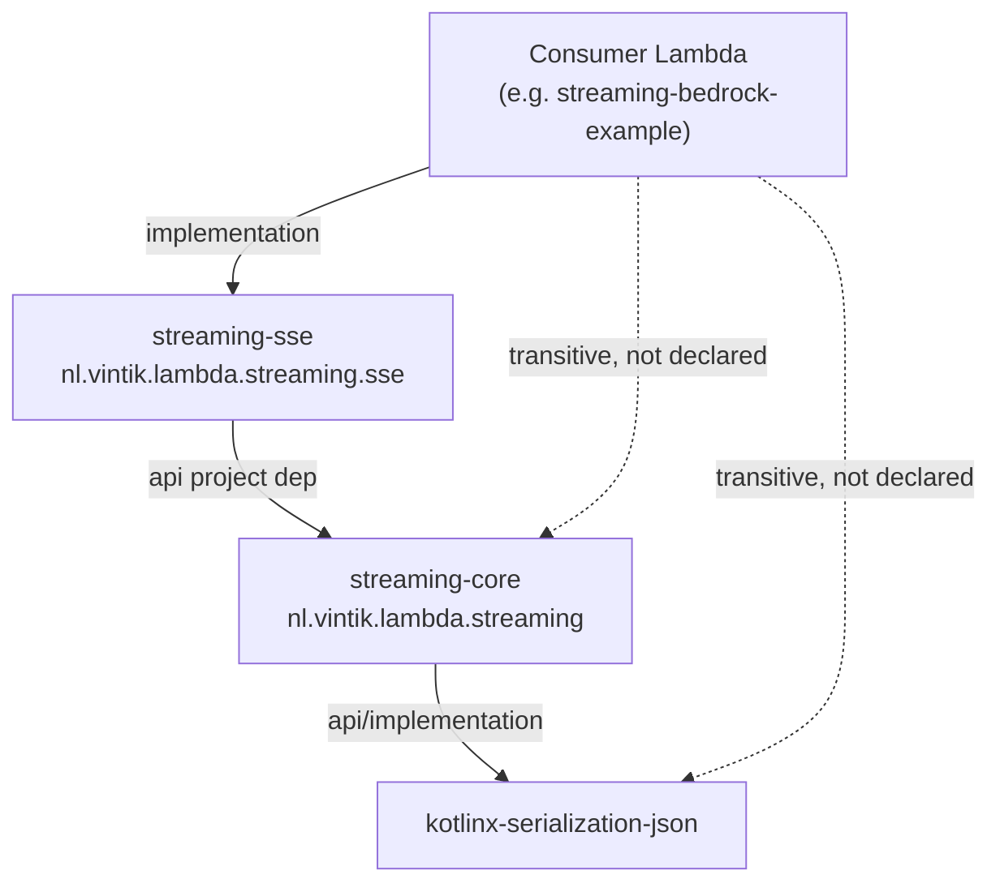
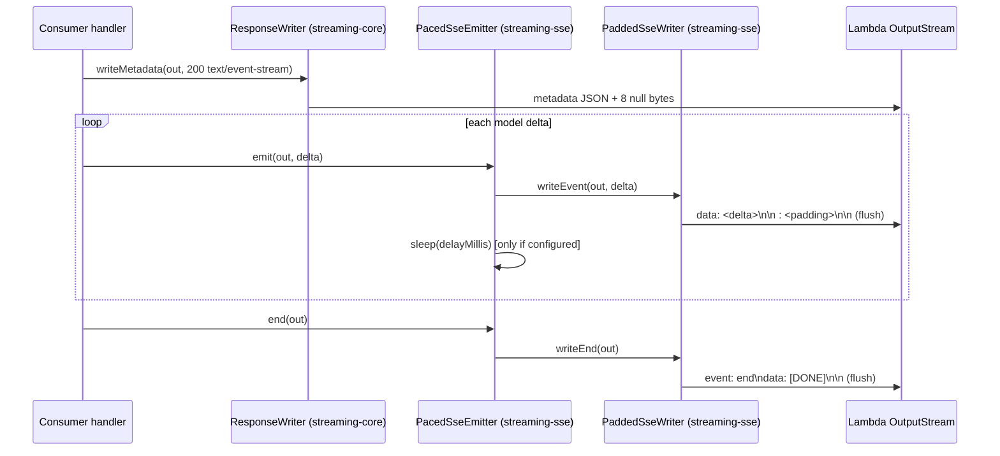

# Design Document

## Overview

This feature promotes the proven SSE padding/dribble workaround out of `streaming-bedrock-example` into a new, reusable Gradle module, `streaming-sse`. The module exists so that this repository's own examples (the Bedrock example today) and the external MockNest project can share one implementation of the mechanism that defeats the AWS Lambda response-streaming runtime's internal buffering.

The core problem the module solves (verbatim from the requirements intro and confirmed in `streaming-bedrock-example/src/main/kotlin/nl/vintik/lambda/bedrock/PaddedSseWriter.kt`): the Lambda streaming runtime holds small writes (a few bytes per LLM token / SSE event) in an internal buffer (~100 KB observed) and only forwards them when that buffer fills or the invocation ends. There is no application-level `flush()` that overrides this. The proven fix is **tiered SSE-comment padding**: inflate the first few events with large (~100 KB) padding to break the initial buffer, then apply smaller (~10 KB) padding to every subsequent event to keep the stream flowing. An inter-chunk *delay* on its own does nothing — without padding, each small write never crosses the buffer and the delayed chunks still coalesce into a terminal burst. The delay only paces delivery *once padding is present*.

The module has two deliverables:

1. **`PaddedSseWriter`** — promoted byte-for-byte from the Bedrock example (Requirement 2, Requirement 5.7). This is a pure SSE + padding encoder. Its wire behaviour does not change.
2. **A new, optional inter-chunk dribble/pacing capability** (Requirement 3) that the local writer does not yet have, designed so the encoder stays pure and testable and the pacing concern is separable.

Scope boundaries (from the requirements): `streaming-sse` depends only on `streaming-core`; it mirrors `streaming-core`'s build, publishing, coverage, and binary-compatibility conventions; changes to `streaming-core`'s public API are out of scope; Function URL support is out of scope.

### Design decisions at a glance

| Decision | Choice | Traces to |
| --- | --- | --- |
| Module package | `nl.vintik.lambda.streaming.sse` | Grounding (core uses `nl.vintik.lambda.streaming`) |
| Writer behaviour | Promote `PaddedSseWriter` unchanged | Req 2, Req 5.7 |
| Pacing location | Separate `PacedSseEmitter` with an injected `sleep: (Long) -> Unit`; writer stays a pure encoder | Req 3, testability |
| Delay-without-padding | Rejected at construction with an observable error (`require`) | Req 3.6 |
| Default padding | Exposed as named public constants `102400 / 10240 / 3` | Req 2.2, Open Q4 |
| Java target | Java 21 toolchain + JVM 21 bytecode, matching `streaming-core` | Req 1.5, Open Q3 |
| Coroutines | Not a dependency; use an injected synchronous sleeper | Grounding / testability |

## Architecture

`streaming-sse` sits between the wire-protocol primitive (`streaming-core`) and a consuming Lambda handler. It owns only the SSE framing and the padding/pacing concerns; it never writes the metadata prelude (that is `streaming-core`'s `ResponseWriter`) and never touches AWS APIs (Requirement 1.4).

### Module dependency graph



The `api(project(":streaming-core"))` edge (Requirement 1.1–1.3) means a consumer that declares only `streaming-sse` still resolves `streaming-core` and its transitive `kotlinx-serialization-json` on both compile and runtime classpaths without declaring either. No AWS coordinate appears anywhere on this graph (Requirement 1.4).

### Request-time collaboration

The prelude-then-events ordering is owned by the consumer handler (as it is today in `BedrockStreamHandler`): `ResponseWriter.writeMetadata(...)` commits the `text/event-stream` 200 status once, then SSE events flow. `streaming-sse` provides the event encoder and the optional pacer; it does not re-implement the metadata prelude.



### Component responsibilities

- **`PaddedSseWriter`** — pure, deterministic SSE encoder. Stateful only in its zero-based `eventIndex`. One `writeEvent` call = one `data:` line + optional padding comment + per-event flush; returns the byte count. No sleeping, no AWS, no coroutines. This is what makes it trivially unit- and property-testable (the existing `PaddedSseWriterTest` + `CountingFlushStream` carry over verbatim).
- **`PacedSseEmitter`** — thin wrapper that owns the *pacing* concern. It holds a `PaddedSseWriter` and an optional validated delay, loops `writeEvent` then `sleep(delay)` between events, and delegates `writeEnd`. The sleeper is injected (`sleep: (Long) -> Unit`, defaulting to `Thread::sleep`) so pacing tests assert the sleep schedule without wall-clock delay.

**Why separate the pacer from the writer (Requirement 3, testability).** Keeping `PaddedSseWriter` free of any time/sleep concern preserves its purity: every existing test stays green and the byte-for-byte guarantee for the Bedrock refactor (Requirement 5.7) is obvious because the class is unchanged. Pacing is a distinct responsibility (when to write, not how to encode), so it lives in its own small type. Injecting the sleeper means the pacing logic — "sleep `delay` ms in the gap between events, never before the first or after the last" — is verified by recording calls to a fake sleeper, with zero real delay in the test suite.

**Why an injected sleeper instead of coroutines.** Steering mentions `kotlinx-coroutines-test`, which would let a `delay()` be virtualised on a test dispatcher. But pulling coroutines into `streaming-sse` would add a runtime dependency to a library whose entire point is a minimal, AWS-free, nearly-dependency-free surface (it currently needs only what `streaming-core` transitively provides). A consumer like `BedrockStreamHandler` already drives the relay inside its own `runBlocking { ... }`; a synchronous `Thread.sleep` inside that block paces correctly without `streaming-sse` itself knowing about coroutines. The trade-off: a blocking sleep parks the calling thread. In a Lambda that is acceptable — the invocation is single-request and the thread is dedicated to producing this response. So the design picks the **injected synchronous sleeper**; coroutine-based pacing is not warranted at this scope.

## Components and Interfaces

All public declarations are under `explicitApi()` (Requirement 1.6), so every signature below states visibility and return type. These signatures are the authoritative source for the committed `streaming-sse/api/streaming-sse.api` dump (Requirement 1.9).

Package: `nl.vintik.lambda.streaming.sse`

### `PaddedSseWriter`

Promoted unchanged from `nl.vintik.lambda.bedrock.PaddedSseWriter` (only the package changes). Wire behaviour is identical (Requirement 2, Requirement 5.7).

```kotlin
public class PaddedSseWriter(
    private val headPadBytes: Int,
    private val tailPadBytes: Int,
    private val headPadEvents: Int,
) {
    // Convenience ctor applying the module defaults (Req 2.2).
    public constructor()

    /** Writes `data: <text>\n\n` then, if the tier's pad > 0, `: <spaces>\n\n`; flushes; returns bytes written (incl. padding). */
    public fun writeEvent(output: OutputStream, text: String): Int

    /** Writes the exact terminal bytes `event: end\ndata: [DONE]\n\n` and flushes. */
    public fun writeEnd(output: OutputStream)

    /** Zero-based count of events written so far. */
    public fun eventsWritten(): Int
}
```

- Construction rejects any negative tier value with `IllegalArgumentException` via `require` (Requirement 2.11), exactly as today.
- Head tier applies to events with zero-based index `< headPadEvents` (Requirement 2.3); tail tier to index `>= headPadEvents` (Requirement 2.4).
- Pad == 0 omits the comment line (Requirement 2.6, 2.7); each `writeEvent` flushes before returning (Requirement 2.8) and returns the byte count (Requirement 2.9).

### `PacedSseEmitter`

New. Owns the optional inter-chunk delay (Requirement 3) and delegates all encoding to a `PaddedSseWriter`.

```kotlin
public class PacedSseEmitter(
    private val writer: PaddedSseWriter,
    private val delayMillis: Int = NO_DELAY,
    private val sleep: (Long) -> Unit = Thread::sleep,
) {
    /**
     * Writes one event via the writer, then — if a delay is configured and this is not the
     * boundary where a following event never comes — pauses for `delayMillis`.
     * Returns the byte count from the underlying writer.
     */
    public fun emit(output: OutputStream, text: String): Int

    /** Delegates to writer.writeEnd; never applies a trailing delay. */
    public fun end(output: OutputStream)

    public fun eventsWritten(): Int

    public companion object {
        /** Sentinel meaning "no pacing": events are written with zero added pause (Req 3.2). */
        public const val NO_DELAY: Int = 0
        public const val MIN_DELAY_MILLIS: Int = 1
        public const val MAX_DELAY_MILLIS: Int = 5000
    }
}
```

Construction-time validation (all `require`, all observable via `IllegalArgumentException`, nothing retained on failure):

- A configured delay above `MAX_DELAY_MILLIS` is rejected (Requirement 3.3).
- A configured delay below `MIN_DELAY_MILLIS` that is not the `NO_DELAY` sentinel is rejected (Requirement 3.4).
- A delay in `[1, 5000]` combined with a writer whose padding is entirely zero (`headPadBytes == 0 && tailPadBytes == 0`) is rejected (Requirement 3.6) — delay alone cannot cross the runtime buffer. To enforce this, `PaddedSseWriter` exposes its padding tiers to the emitter; see Data Models.

The delay is applied *in the gap between completing one event write and starting the next* (Requirement 3.1) and only after the padded event has been written and flushed (Requirement 3.5). `emit` flushes (via the writer) before sleeping, so each paced chunk crosses the buffer before the pause.

### Pacing boundary semantics

"Pause in the gap between events" (Requirement 3.1) means a sleep occurs *after* an event write only when another event will follow. With no look-ahead available inside a single `emit` call, the implementation applies the delay *before* every event except the first (i.e. "sleep, then write" for events 2..n), which produces exactly the same inter-event gaps and guarantees no pause after the final event and none before the first. `end` never sleeps.

## Data Models

### Padding tiers and default constants (Requirement 2.2, Open Question 4)

The defaults are exposed as named public constants on `PaddedSseWriter`'s companion (recommendation for Open Question 4: expose them — they are a documented part of the mechanism and consumers like the Bedrock priming hook and MockNest benefit from referencing the same names rather than copying magic numbers):

```kotlin
public companion object {
    /** ~100 KB — breaks the initial Lambda streaming-runtime buffer (Req 2.2). */
    public const val DEFAULT_HEAD_PAD_BYTES: Int = 102_400
    /** ~10 KB — keeps the stream flowing on every subsequent event (Req 2.2). */
    public const val DEFAULT_TAIL_PAD_BYTES: Int = 10_240
    /** Number of leading events that receive head padding (Req 2.2). */
    public const val DEFAULT_HEAD_PAD_EVENTS: Int = 3
}
```

The no-arg `PaddedSseWriter()` convenience constructor applies exactly these three values (Requirement 2.2).

### Padding-presence query (supports Requirement 3.6)

So `PacedSseEmitter` can reject delay-without-padding, `PaddedSseWriter` exposes whether it carries any padding:

```kotlin
/** True when at least one tier carries padding bytes (headPadBytes > 0 || tailPadBytes > 0). */
public fun hasPadding(): Boolean
```

This keeps the tier fields `private` (minimum visibility per steering) while giving the emitter the single fact it needs.

### SSE wire format (data model of the output bytes)

Per event (`writeEvent`):

```
data: <text>\n\n
: <padding spaces>\n\n        # only when the tier's pad > 0
```

Terminal (`writeEnd`), exact bytes (Requirement 2.10):

```
event: end\ndata: [DONE]\n\n
```

All bytes are UTF-8. Padding is **only ever** emitted inside a `: ` comment line (Requirement 4.3), which is why a `sed -n 's/^data: //p'` filter never sees it.

## Correctness Properties

*A property is a characteristic or behavior that should hold true across all valid executions of a system — essentially, a formal statement about what the system should do. Properties serve as the bridge between human-readable specifications and machine-verifiable correctness guarantees.*

This module encodes/pads text and paces writes — it is a pure data transformation with a large, structured input space (arbitrary payloads, padding tiers, event counts), which is exactly where property-based testing adds value. The round-trip in Requirement 4 is the canonical "always include a round-trip for a serializer/encoder" property.

### Property 1: Payload round-trips through the padded stream (excluding terminal)

*For any* sequence of events (1–20 events, each payload 0 bytes up to a few KB, including payloads with a leading `:`, the literal `data:`, embedded newlines, and multi-byte UTF-8) and *for any* valid padding tier, applying `sed -n 's/^data: //p'` to the written output excluding the terminal event reproduces the concatenation of the original event texts byte-identically.

**Validates: Requirements 4.1, 4.4, 4.5, 4.6**

### Property 2: Full-stream round-trip adds exactly the `[DONE]` sentinel

*For any* such event sequence, applying `sed -n 's/^data: //p'` to the full stream including the terminal event yields the concatenation of the original event texts followed by exactly one trailing `[DONE]` line and nothing else.

**Validates: Requirements 4.2, 4.7**

### Property 3: Padding lives only in comment lines

*For any* event and *for any* padding tier, every padding byte appears only within a `: ` SSE comment line; no `data:` line and no non-terminal line visible to the `sed` filter is affected by padding.

**Validates: Requirements 4.3, 4.7**

### Property 4: Tiered padding crosses the buffer threshold

*For any* configuration with `headPadBytes >= 100000`, each of the first `headPadEvents` written events has a total byte size exceeding the observed ~100 KB runtime buffer, and *for any* `tailPadBytes > 0`, each subsequent event carries at least `tailPadBytes` of padding — so every flushed event is large enough to be forwarded rather than buffered.

**Validates: Requirements 2.3, 2.4, 2.6**

### Property 5: Returned byte count equals bytes written

*For any* event text and padding tier, the value returned by `writeEvent` equals the exact number of UTF-8 bytes written to the stream for that event (data line + optional padding comment).

**Validates: Requirements 2.9**

### Property 6: Pacing sleeps once per inter-event gap and never at the boundaries

*For any* configured delay in `[1, 5000]` and *for any* event count n, emitting n events then calling `end` invokes the injected sleeper exactly n−1 times, each with the configured delay, with no sleep before the first event and none after the last or on `end`.

**Validates: Requirements 3.1, 3.5**

### Property 7: No pacing means no added pause

*For any* event sequence emitted with `delayMillis == NO_DELAY`, the injected sleeper is never invoked.

**Validates: Requirements 3.2**

> Property reflection: candidate properties "adding an event increases emitted output" and "writeEvent flushes once" were folded into Properties 1/5 (round-trip already proves the data line is present and correct; the flush-once behaviour is an example-based unit test, not a universal property worth 100 iterations). Properties 1 and 2 are kept distinct because the terminal-sentinel reconciliation (Requirement 4.2 vs 4.1) is a separate guarantee, not implied by the non-terminal round-trip.

## Error Handling

All validation is construction-time and fail-fast, using Kotlin `require` (maps to `IllegalArgumentException`), consistent with the existing writer and with steering ("`require`/`requireNotNull` for bug detection"). No partially-constructed object is retained because the exception is thrown from the `init`/constructor before the reference escapes (Requirement 2.11, 3.3, 3.4).

| Condition | Handling | Traces to |
| --- | --- | --- |
| `headPadBytes`, `tailPadBytes`, or `headPadEvents` negative | `require(... >= 0)` → `IllegalArgumentException`, message naming the offending value | Req 2.11 |
| Delay > 5000 ms | `require(delayMillis <= MAX_DELAY_MILLIS)` → reject, prior valid config retained (new object never constructed) | Req 3.3 |
| Delay < 1 ms and not `NO_DELAY` | `require(delayMillis == NO_DELAY || delayMillis >= MIN_DELAY_MILLIS)` → reject | Req 3.4 |
| Delay configured with zero padding | `require(delayMillis == NO_DELAY || writer.hasPadding())` → reject with a message explaining delay alone cannot cross the runtime buffer | Req 3.6 |

"Retain the prior valid configuration" (Requirement 3.3/3.4) is satisfied structurally: configuration is immutable constructor state, so a rejected construction throws and leaves any previously-built emitter untouched; there is no mutable setter to corrupt.

Runtime I/O errors (a broken `OutputStream`) propagate to the caller unchanged — `streaming-sse` does not swallow them. The consumer handler owns the status-commit/truncation policy (as `BedrockStreamHandler` already does); the library's job is only to encode and pace. Per steering, the consumer logs at WARN+ before handling; the library itself performs no logging (no logging dependency, matching `streaming-core`).

## Testing Strategy

Dual approach, mirroring the existing `PaddedSseWriterTest` which moves into this module (and is deleted from the Bedrock example per Requirement 5.4).

### Unit tests (examples, edge cases, error conditions)

Carried over / added using JUnit 6 (`useJUnitPlatform()`) and the existing `CountingFlushStream` helper:

- `writeEvent` emits one `data:` line and flushes exactly once (example).
- Head tier produces larger events than tail tier (example).
- Zero padding omits the comment line (edge case).
- `writeEnd` emits the exact terminal bytes (example, Requirement 2.10).
- Negative construction params rejected (Requirement 2.11).
- `PacedSseEmitter` rejects delay > 5000, delay < 1 (non-sentinel), and delay-with-zero-padding (Requirements 3.3, 3.4, 3.6) — each asserted via `assertThrows(IllegalArgumentException::class.java)`.
- `end` never sleeps; `NO_DELAY` never sleeps (examples backing Properties 6/7).

### Property-based tests (universal properties)

Implemented with JUnit 6 `@ParameterizedTest` + `@MethodSource`/`@ValueSource` (the repo's PBT style — see the existing `tokenAndPadCases` source), **not** a bespoke framework. Each property test:

- Runs a diverse corpus of 10–20 cases (steering) and is tagged `// Feature: streaming-sse-module, Property N: <text>` referencing the design property.
- The round-trip corpus (Properties 1–3) includes the required cases from Requirements 4.5–4.6: a payload with a leading `:`, a payload containing literal `data:`, a payload with embedded `\n`, a multi-byte UTF-8 payload, an empty-payload case, and an empty-sequence case. Larger fixtures, if any, live in `src/test/resources/test-data/`.
- Round-trip assertion mirrors the client filter: split output into lines, keep those starting with `data: `, strip the prefix, compare to the original concatenation (excluding terminal for Property 1; including the single trailing `[DONE]` for Property 2).
- Pacing properties (6/7) inject a recording sleeper (`(Long) -> Unit` capturing each argument) so the sleep schedule is asserted with **zero wall-clock delay**. No coroutines, no real `Thread.sleep` in the suite.

### Build / verification gates

- **Kover 90%** line coverage (`koverVerify` rule `minValue = 90`), matching `streaming-core` (Requirements 1.7, 1.8). The module is small and pure, so 90% is readily met.
- **Binary compatibility**: `apiDump` generates and `apiCheck` verifies `streaming-sse/api/streaming-sse.api`, in the same format as `streaming-core/api/streaming-core.api` (Requirements 1.9, 1.10). The committed dump lists exactly the public surface in Components and Interfaces.
- **No-AWS-coordinates check**: the repo-level `resolvedCoordinates` baseline task (root `build.gradle.kts`) already emits resolved `group:name:version` per configuration; the module's compile/runtime classpaths must contain no coordinate whose group starts with `aws`, `software.amazon`, or `com.amazonaws` (Requirement 1.4). This is asserted by diffing/grepping that task's output for the module.
- **Transitivity check**: because the Bedrock example will depend on `streaming-sse` without declaring `streaming-core`, a successful Bedrock build is itself the proof of Requirement 1.3; the `resolvedCoordinates` report for the Bedrock module shows `streaming-core` present transitively.

### Deployed-endpoint verification (out of unit scope, Requirement 5.6–5.7)

Requirements 5.6 (first chunk before full completion) and 5.7 (byte-identical content vs pre-refactor) are proven by the existing `Post_Deploy_Test` against the deployed Bedrock endpoint — no local emulator implements the streaming runtime's buffering, so progressive delivery can only be proven against real AWS (steering). The refactor keeps the writer's bytes identical, so 5.7 holds by construction.

## Bedrock Example Refactor (Requirement 5)

- `streaming-bedrock-example/build.gradle.kts` adds `implementation(project(":streaming-sse"))` (Requirement 5.1). It keeps `implementation(project(":streaming-core"))` only if it still uses core types directly (it does — `ResponseWriter`, `ResponseMetadata`); otherwise it could rely on the api-scoped transitivity, but keeping the explicit declaration is clearer and allowed.
- `BedrockStreamHandler` and `Priming` import `nl.vintik.lambda.streaming.sse.PaddedSseWriter` instead of the local `nl.vintik.lambda.bedrock.PaddedSseWriter` (Requirement 5.2).
- Delete `streaming-bedrock-example/src/main/kotlin/nl/vintik/lambda/bedrock/PaddedSseWriter.kt` (Requirement 5.3) and `streaming-bedrock-example/src/test/kotlin/nl/vintik/lambda/bedrock/PaddedSseWriterTest.kt` (Requirement 5.4); the test moves to `streaming-sse/src/test/kotlin/nl/vintik/lambda/streaming/sse/`.
- The handler may optionally adopt `PacedSseEmitter` if dribble pacing is wanted; the default (no delay) preserves current behaviour exactly, so the byte-identical guarantee (Requirement 5.7) holds whether or not pacing is enabled.
- Build passes with zero references to a local `PaddedSseWriter` (Requirement 5.5) — verified by a successful `./gradlew :streaming-bedrock-example:build` and a grep showing no `nl.vintik.lambda.bedrock.PaddedSseWriter`.

## Module Build Configuration

`streaming-sse/build.gradle.kts` mirrors `streaming-core/build.gradle.kts` exactly, with only the coordinates and the project dependency differing:

- Plugins: versionless `kotlin("jvm")`, `kotlin("plugin.serialization")`, `id("org.jetbrains.kotlinx.kover")` (inherited from the root's `apply false`); module-local `alias(libs.plugins.maven.publish)` and `alias(libs.plugins.bcv)`.
- `group = "nl.vintik"`; `version = providers.gradleProperty("releaseVersion").getOrElse("2.0.0-SNAPSHOT")` (Requirement 1.12 — same git-tag-driven property as core, so both release at one version from one tag).
- Dependency: `api(project(":streaming-core"))` (Requirements 1.1, 1.2) — the only non-test project dependency. (Serialization plugin is applied for parity/consumer convenience even though the writer itself needs no serializer; it adds no AWS surface.)
- Java toolchain 21 + `JvmTarget.JVM_21` (Requirement 1.5, Open Question 3).
- `kotlin { explicitApi() }` (Requirement 1.6).
- `tasks.test { useJUnitPlatform { excludeTags(...) } ; systemProperty("net.bytebuddy.experimental", "true") }` — identical to core.
- `kover { reports { verify { rule { bound { minValue = 90 } } } } }` (Requirements 1.7, 1.8).
- `mavenPublishing { publishToMavenCentral(); signAllPublications(); coordinates("nl.vintik", "aws-lambda-streaming-sse", version.toString()); pom { ... } }` (Requirement 1.13) — distinct artifact id vs core's `aws-lambda-streaming-core`.
- Test deps: `libs.junit.jupiter`, `libs.mockk`, `testRuntimeOnly(libs.junit.platform.launcher)`.

Root `build.gradle.kts`: add `kover(project(":streaming-sse"))` to the aggregation and `:streaming-sse` to `validationReports`/the `koverXmlReport` dependsOn list, so the new module participates in the aggregated Codecov report (consistency with the existing root setup).

`settings.gradle.kts`: add `include("streaming-sse")` (Requirement 1.11).

## Documentation Plan (Requirements 6 and 7)

### Module README (`streaming-sse/README.md`) — Requirement 6

- **Cause** (6.1): the Lambda streaming runtime buffers small writes (~100 KB) below the language layer and releases them only when the buffer fills or the stream ends; no app-level flush overrides it.
- **Workaround** (6.2): tiered SSE-comment padding (large head padding to break the initial buffer, smaller tail padding to keep flowing) plus the optional inter-chunk dribble.
- **Verifiable claim** (6.3): an inter-chunk delay alone does not cross the buffer and is effective only combined with padding — mirrored in code by Requirement 3.6's rejection.
- **Bandwidth trade-off** (6.4): padding inflates the on-the-wire size roughly 100×–1000× relative to the original payload.
- **Citation** (6.5): a resolvable link to the AWS Builder Center article describing the runtime-buffer behaviour.

### Build log (`docs/log.md`) — Requirement 7

Append entries recording: the runtime-buffer finding (small writes held below the language layer, released only on fill/end) (7.1); the tiered-padding workaround making delivery progressive (7.2); that delay-without-padding yields a terminal burst, not progressive delivery (7.3); and the bandwidth trade-off of padding (7.4).

## Addressing the Open Questions

1. **Publishing now vs later.** Recommend publishing to Maven Central from the first increment (keep Requirement 1.13 in scope). The build cost is near-zero since it mirrors `streaming-core`, MockNest is an external consumer that benefits from a published coordinate, and lockstep git-tag versioning (Requirement 1.12) already couples the releases. The deferred BOM decision stands — api-scoped transitivity (1.1–1.3) covers the two-module case.
2. **Content-agnostic primitive split.** Recommend a single SSE-specific `PaddedSseWriter` for now; do not extract a separate content-agnostic "minimum-chunk padding" primitive yet. The only known consumers are SSE consumers, and YAGNI applies. The seam is preserved: the padding-size computation is an internal detail of `writeEvent`, so a future `MinChunkPadder` could be factored out without changing the public SSE API.
3. **Java 21 target.** Confirmed: Java 21 toolchain + JVM 21 bytecode, matching `streaming-core` (Requirement 1.5). The steering Java 25 target is an *example-module* convention; a library's bytecode target is a floor for every consumer and Java 21 is a supported Lambda runtime, so the discrepancy is accepted and intentional for a published library.
4. **Named default constants.** Recommend exposing `DEFAULT_HEAD_PAD_BYTES = 102400`, `DEFAULT_TAIL_PAD_BYTES = 10240`, `DEFAULT_HEAD_PAD_EVENTS = 3` as public constants with a no-arg convenience constructor that applies them (Requirement 2.2). This gives consumers (the Bedrock priming hook, MockNest) a single named source instead of copied magic numbers.
