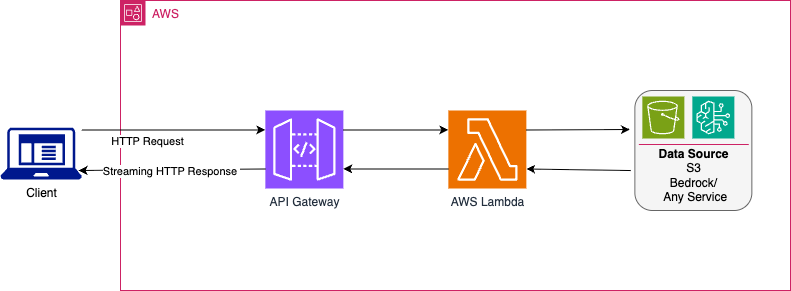
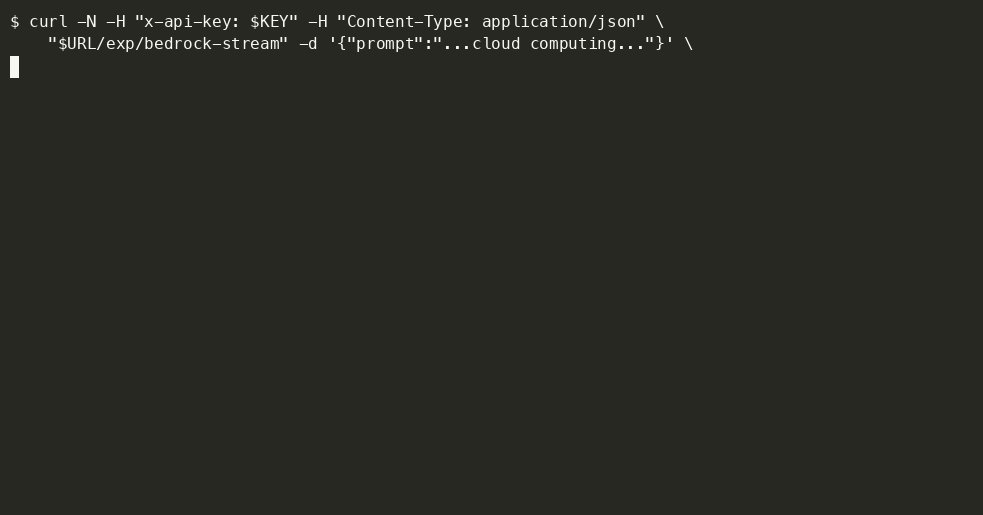

# aws-lambda-streaming-core

[](https://github.com/elenavanengelenmaslova/aws-lambda-response-streaming-jvm/releases/latest)
[](https://central.sonatype.com/artifact/nl.vintik/aws-lambda-streaming-core)
[](https://github.com/elenavanengelenmaslova/aws-lambda-response-streaming-jvm/actions/workflows/ci-main-build.yml)
[](https://codecov.io/gh/elenavanengelenmaslova/aws-lambda-response-streaming-jvm)
[](https://github.com/elenavanengelenmaslova/aws-lambda-response-streaming-jvm/security/code-scanning)

[](https://kotlinlang.org)
[](https://openjdk.org)
[](https://opensource.org/licenses/MIT)

<p align="center">
  
</p>

A JVM library that implements the **AWS Lambda / API Gateway HTTP response streaming protocol** for Kotlin and Java.



AWS provides Node.js helpers (`HttpResponseStream.from()`) that hide the wire format. On the JVM there is no equivalent — you write the protocol by hand or use this library.

For the background and a walkthrough of the library, read the article [AWS Lambda Response Streaming for Kotlin and Java](https://medium.com/aws-in-plain-english/aws-lambda-response-streaming-for-kotlin-and-java-646d8c51f7a0) on Medium.

## What the library does

When a Lambda is configured for response streaming, API Gateway expects a specific binary format on the output stream:

```
[metadata JSON] [8 null bytes] [body bytes…]
```

The library handles:

- **Protocol encoding** — serializes the metadata JSON (`statusCode`, `headers`) and writes the 8-byte delimiter before any body bytes (`ResponseWriter`)
- **Memory-bounded streaming** — copies the body through a fixed 1 MB buffer with per-chunk flush, keeping memory flat regardless of payload size (`copy()`)

This library targets **API Gateway** response streaming (`ResponseTransferMode: RESPONSE_STREAM`): API Gateway invokes the function with the streaming API and re-streams this `[metadata JSON] [8 null bytes] [body…]` payload to the client. The library never touches the invocation layer — it only writes the wire format.

Lambda Function URLs are not supported on the managed JVM runtime — see [Limitations](#limitations).

## Dependency

```kotlin
implementation("nl.vintik:aws-lambda-streaming-core:2.3.1")
```

**One dependency:** `kotlinx-serialization-json`, for metadata encoding. No AWS artifacts — this module implements the wire protocol and never touches the Lambda or S3 APIs, so you bring your own `aws-lambda-java-core` for the `RequestStreamHandler` interface. No logging framework either: every failure propagates to your code, which has the request context needed to log it usefully.

Compiled for **Java 21**, so it runs on the `java21` and `java25` Lambda runtimes alike.

## Usage

Implement `RequestStreamHandler` and use `ResponseWriter` to write the streaming protocol. The pattern is: resolve the streaming source (your logic), then let the library handle the wire format.

**Kotlin**

```kotlin
class MyHandler : RequestStreamHandler {
    private val writer = ResponseWriter()

    override fun handleRequest(input: InputStream, output: OutputStream, context: Context) {
        output.use {
            // Your logic: parse the event, validate, confirm the source exists
            val source = resolveSource(input) ?: run {
                writer.writeError(output, 400, "Bad request.")
                return@use
            }

            // Stream it — the library handles the wire protocol
            source.openBody().use { body ->
                writer.writeMetadata(output, ResponseMetadata(
                    statusCode = 200,
                    headers = mapOf(
                        "Content-Type" to "application/octet-stream",
                        "Content-Length" to source.size.toString(),
                    ),
                ))
                copy(body, output)
                output.flush()
            }
        }
    }
}
```

**Java**

```java
public class MyHandler implements RequestStreamHandler {
    private final ResponseWriter writer = new ResponseWriter();

    @Override
    public void handleRequest(InputStream input, OutputStream output, Context context)
            throws IOException {
        try (output) {
            // Your logic: parse the event, validate, confirm the source exists
            var source = resolveSource(input);
            if (source == null) {
                writer.writeError(output, 400, "Bad request.");
                return;
            }

            // Stream it — the library handles the wire protocol
            try (var body = source.openBody()) {
                writer.writeMetadata(output, new ResponseMetadata(
                    200,
                    Map.of("Content-Type", "application/octet-stream",
                           "Content-Length", String.valueOf(source.size())),
                    null));
                BoundedBufferKt.copy(body, output);
                output.flush();
            }
        }
    }
}
```

`resolveSource(input)` is your code — it parses the API Gateway event, validates the request, confirms the source exists (e.g. S3 `headObject`), and returns something with a `size` and an `openBody()` that gives you an `InputStream`. The library takes over from `writeMetadata` onwards.

`ResponseWriter` owns the wire encoding. Once `writeMetadata` returns, the status is committed — a later failure can only truncate the body, never rewrite the status.

## API reference

| Type | Description |
|---|---|
| `ResponseWriter` | Writes the metadata JSON + 8-byte delimiter |
| `ResponseWriter.writeMetadata(output, metadata)` | Commits status + headers, writes delimiter |
| `ResponseWriter.writeResponse(output, metadata, body?)` | Whole response in one call: metadata, delimiter, optional body, flush |
| `ResponseWriter.writeError(output, status, message)` | Convenience error response — `application/json` with a `{"message":…}` body. For any other shape, build it and call `writeResponse` |
| `ResponseMetadata` | Data class: `statusCode: Int`, `headers: Map<String, String>`, `cookies: List<String>?` |
| `ResponseMetadata.fromMultiValue(status, headers)` | Collapses `Map<String, List<String>>` — joins values with `", "`, routes `Set-Cookie` to `cookies` |
| `copy(source, sink, flush?)` | 1 MB bounded copy utility; `flush` defaults to flushing the sink |
| `DELIMITER_LEN` | The 8-byte delimiter length constant |
| `OBSERVED_MAX_PRELUDE_LEN` | Optional prelude ceiling — see below |

### Repeated headers and `Set-Cookie`

The prelude models headers as name → single value, so repeated headers have to be collapsed. `fromMultiValue` joins them with `", "` — except `Set-Cookie`, which it routes to the dedicated `cookies` array. Comma-joining cookies would corrupt them, since a comma is legal inside a cookie's `Expires` date and clients would mis-split the result. When there are no cookies the field is omitted from the JSON entirely.

### Optional prelude size limit

By default the writer imposes no size limit, matching AWS's reference implementation, which validates nothing. If you would rather fail fast than let an oversized prelude reach the runtime — where it may be rejected or silently folded into the response body — opt in:

```kotlin
val writer = ResponseWriter(maxPreludeLen = OBSERVED_MAX_PRELUDE_LEN)
```

An oversized prelude then raises `MetadataTooLargeException` **before anything is written**, so the stream is untouched and the status is still uncommitted — you can write a different response instead. Note that `OBSERVED_MAX_PRELUDE_LEN` (16376) is not an AWS-documented limit; it is the commonly cited 16 KiB budget less the delimiter. A negative `maxPreludeLen` is rejected by the constructor with `IllegalArgumentException`, since no prelude could ever satisfy it.

## Limitations

The standard lambda response streaming limitations still apply; additionally, the streaming method that library uses only works with API gateway and not function URLs:

- **200 MB payload limit.** Streaming increases Lambda's response limit from 6 MB to 200 MB. For larger payloads, use pagination or pre-signed S3 URLs.
- **2 MB/s throughput after 6 MB.** The first 6 MB is uncapped; subsequent data is throttled to 2 MB/s, regardless of Lambda memory or buffer size.
- **Billing after client disconnect.** Lambda continues running and billing until the invocation finishes or times out, even if the client disconnects.
- **API Gateway only.** This library supports response streaming through API Gateway REST APIs, not Lambda Function URLs. For Function URLs, AWS recommends using a custom runtime or Lambda Web Adapter.

## Example modules

| Module | Language | Description |
|--------|----------|-------------|
| [`streaming-s3-example`](streaming-s3-example/) | Kotlin | Streams S3 files via the Kotlin AWS SDK (coroutines) |
| [`streaming-s3-example-java`](streaming-s3-example-java/) | Java | Same functionality using AWS SDK for Java v2 (sync) — proves the library is consumable from plain Java |

The [`streaming-bedrock-example`](streaming-bedrock-example/) shows the workaround: pad each Server-Sent Event past the buffer threshold with an SSE comment line (`:` … — silently ignored by clients), tiered as ~100 KB on the first few events then ~10 KB after, so tokens are delivered as they are generated. The trade-off is bandwidth (the padding inflates the response); the module README has the measured numbers and cites the AWS Builder Center write-up of the same behaviour.



## Contributing and security

| Document | What it covers |
|---|---|
| [`CONTRIBUTING.md`](CONTRIBUTING.md) | Build commands, test tags, coverage gates, the version-catalog rule, commit conventions, and the checks to run before opening a pull request |
| [`SECURITY.md`](SECURITY.md) | How to report a vulnerability privately, the response windows, and what each security and quality tool here is for |
| [`CODE_OF_CONDUCT.md`](CODE_OF_CONDUCT.md) | Expected and unacceptable behaviour, scope, and the enforcement contact |

Repository settings only the owner can change — accounts, secrets, labels, security toggles — are listed once, in dependency order, under [Maintainer setup checklist](CONTRIBUTING.md#maintainer-setup-checklist).

## License

See LICENSE file.
