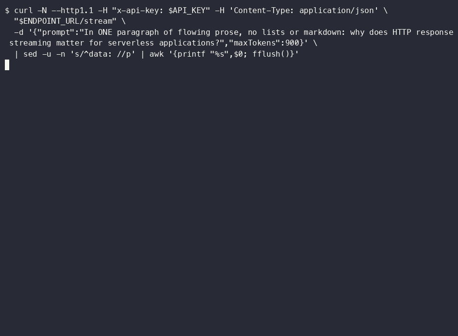

# Streaming Amazon Bedrock tokens from a Kotlin Lambda as Server-Sent Events

### Progressive token delivery through API Gateway REST, without a custom runtime or Lambda layer

In the previous article, "AWS Lambda Response Streaming for Kotlin and Java" [1], we streamed a large
S3 object from a Kotlin Lambda through API Gateway REST, aiming at large blobs that exceed the Lambda
and API Gateway buffered response limits. That worked: `copy()` in `streaming-core` writes the body in
1 MiB chunks from any `InputStream`, and a 12 MB object reaches the client in full.

When I applied the same approach to Amazon Bedrock output, it did not work the way I wanted. Bedrock
produced its tokens progressively, the handler wrote and flushed every delta, and the client still
received the whole answer in one burst at the end.

My first explanation was the one in the AWS Builder Center article "The Curious Case of SSE Streaming
Agent Responses on AWS Lambda" [2]: a buffer inside the Lambda streaming runtime that holds small
writes until it fills, at roughly 100 KB, defeated by padding each event with SSE comment lines. I
implemented that, it produced something that looked progressive, and I shipped it.

Then I measured it properly, and the explanation turned out to be wrong. On the managed JVM runtime
there is no buffer to defeat, because **nothing leaves the execution environment until the handler
returns** — at any write size. Padding never made the stream progressive. It made the finished
response large enough that *downloading* it took long enough to look progressive, which is not the
same thing and costs a great deal of bandwidth.

This article is the corrected version: what the managed JVM runtime really does, why the S3 example
is still fine, why padding is not, and what does work — token-by-token delivery with no padding at
all, still with no custom runtime and no Lambda layer.

## Demo and architecture

The deployed endpoint, called with `curl`. Words appear a few at a time while the model is still
generating. There is no padding to filter out.




The client sends `POST /stream` with `{"prompt":"...","maxTokens":N}`. API Gateway invokes the Lambda
in streaming mode, the handler calls Bedrock Nova Lite with `InvokeModelWithResponseStream`, and each
text delta is written back to the client as an SSE event.

## What the managed JVM runtime actually does

It helps to separate what we observed, what AWS documents, and what is inferred.

**Observed.** The `OutputStream` a `RequestStreamHandler` receives on the managed `java25` runtime is
a `java.io.ByteArrayOutputStream` — the handler can log its class name and see this. To find out when
its contents leave, I deployed a function that writes a block of bytes, flushes, then sleeps before
returning, and compared the handler's own timing lines with the API Gateway access log fields
`$context.integration.timeToFirstContent` and `$context.integration.timeToAllHeaders` [5]:

| Written | When written | Handler returned | API Gateway received first content |
|---|---|---|---|
| 15 MB | 2 ms | 10,003 ms | 10,069 ms |
| 1 KB | 0 ms | 10,001 ms | 10,029 ms |

The whole body sat in the sandbox for ten seconds while the handler was idle. The response
*headers* arrived at the same moment as the body, not when the handler wrote them. The same shape
held on the S3 example: the prelude was written at 14 ms and reached API Gateway at 1,102 ms, after
all 12.58 MB had been written and the handler had closed.

`Max Memory Used` also grew with the response: five consecutive 12 MB requests in one execution
environment reported 205, 217, 229, 241 and 253 MB — about the object size per request.

**Documented.** AWS documents managed-runtime response streaming for Node.js and points other
languages to a custom runtime or the Lambda Web Adapter [3]. The Java runtime interface client is
open source, and its handler wrapper keeps a `ThreadLocal<ByteArrayOutputStream>`, hands it to
`handleRequest`, and returns it to the invocation loop afterwards [8]. A maintainer reply on the same
repository states that response streaming is Node.js-only [9]. So the behaviour is not a bug; the
managed Java runtime simply has no streaming path.

**Inferred.** Our measurements show when bytes reach API Gateway, not which layer held them. The
source above is consistent with the handler's stream being a plain heap buffer, which is also what
the observed class name suggests.

## Why the S3 example is still fine

Two things are true at once, and it is worth keeping them apart.

**The transport really is a streaming one.** The access log reports
`$context.integration.responseTransferMode` as `STREAM`, and the integration URI is Lambda's
`/response-streaming-invocations` path. That is what lifts the 6 MB buffered Lambda response limit [3]
and API Gateway's 10 MB buffered limit [4] — a 12 MB or 21 MB object is delivered at all only because
of it. API Gateway then streams those bytes onward to the client progressively and with bounded
memory on its side.

**But the handler does not produce them incrementally.** For a large file download that mostly does
not matter: the client's first byte arrives as soon as the transfer starts, and a 12 MB body takes
seconds to come down, so time-to-first-byte looks good. What it costs you is memory — the whole
response exists in the function's heap before any of it moves, as the numbers above show — and it
means a handler cannot react to a slow producer.

For large blobs, `streaming-core` on its own is the right tool and the previous article stands. For a
token trickle it is not enough: the thing you want is exactly the thing the buffered path cannot do.

## Why padding does not fix it

Padding each SSE event with comment lines, as in [2], does produce output that arrives in several
time windows at the client. It is worth being precise about why.

With padding, the handler still writes everything into the heap buffer, and the buffer is still
posted after the handler returns. The only thing that changed is the size of the finished response.
A few kilobytes download instantly, so an unpadded answer appears as one burst. Several megabytes
take seconds to download, and a client printing text as it arrives shows it filling in gradually.

Measured on the deployed endpoint, same prompt and model:

| | Bytes on the wire | Client TTFB | TTFB as share of total |
|---|---|---|---|
| No padding | 14 KB | at the end | ~100% |
| Padding, 100 KB × 3 + 10 KB | 18 MB | 8.68 s of 12.48 s | 70% |

Time to first *token* got worse, not better, and the response carried about 1,280 times more bytes.
The visual effect is a typewriter animation produced by a slow download — the same effect a client
can produce locally, for free, without delaying completion. [2] reports a Python/FastAPI stack behind
the Lambda Web Adapter, which posts to the Runtime API incrementally; I can only say that on the
managed Java runtime the mechanism is different and padding is not the lever.

I removed `PaddedSseWriter` and `PacedSseEmitter` from `streaming-sse` because of this.

## What does work: post the response yourself

The managed runtime's buffered stream is not the only way to answer an invocation. The Lambda Runtime
API, which a custom runtime talks to, accepts a response as a **chunked HTTP request** — and it is
reachable from handler code at `$AWS_LAMBDA_RUNTIME_API` inside the sandbox.

Three settings make that request stream:

```kotlin
val connection = (URI("http://$endpoint/2018-06-01/runtime/invocation/$requestId/response")
    .toURL().openConnection() as HttpURLConnection).apply {
    requestMethod = "POST"
    doOutput = true
    setChunkedStreamingMode(0)                                       // chunked transfer encoding
    setRequestProperty("Lambda-Runtime-Function-Response-Mode", "streaming")
    setRequestProperty("Content-Type", "application/vnd.awslambda.http-integration-response")
}
```

The content type is the marker that Node's `awslambda.HttpResponseStream.from()` sets through
`setContentType`: it tells the service the body opens with the metadata prelude. So the wire format
is unchanged — `streaming-core`'s `ResponseWriter` writes the same prelude, the same eight-byte
delimiter and the same body as before. Only the destination differs, and the destination is a socket
instead of a heap buffer.

That alone is not enough. After the handler returns, AWS's invocation loop posts *its* response for
an invocation that is already answered, the post fails, and the runtime process exits — every
invocation ends as `Runtime.ExitError`, even though the client received a correct, complete response.

### Stopping the duplicate post

The loop needs one change: skip its post when the handler has already answered. Three ways to get
there, and only the last is usable.

The runtime interface client cannot be replaced from the deployment package. `/var/task` is not on
the JVM classpath at all — the runtime launches with only its own jars on `-classpath`, and customer
code is loaded separately by a `CustomerClassLoader` — so a class shipped under a runtime package
name can never win.

`AWS_LAMBDA_EXEC_WRAPPER`, which is supported on all managed runtimes [10], can rewrite the runtime's
command line and substitute a whole invocation loop. That works, and it streams. It also silently
stops CRaC hooks from firing, so SnapStart priming quietly stops running: in a control comparison,
`beforeCheckpoint` fired under AWS's loop and never fired under a replacement. It needs an executable
script in the package, which a library cannot ship.

A **Java agent** is the one that fits. `premain` runs before the runtime's `main`, so AWS's loop stays
in place — including whatever drives the CRaC callbacks — and the agent patches a single method:

```java
// LambdaRuntimeApiClientImpl
void reportInvocationSuccess(String requestId, byte[] response, String xrayHeader) {
    if (StreamingState.alreadyAnswered()) return;   // ← injected
    …
}
```

Everything else is left byte-identical: fetching the next invocation, the SnapStart restore hook,
error reporting, logging. An agent is also just a jar plus one flag, which means it can ship as a
library dependency.

It fails safe. If the jar cannot be loaded or the runtime method has changed, nothing is patched and
the function keeps working on the normal buffered path. `StreamingAgent.isPatched()` reports the
truth, and `StreamingResponse` refuses to stream when the patch is absent — so a runtime change shows
up as one clear error instead of a failed invocation per request.

## Setup: three steps

```kotlin
implementation("nl.vintik:aws-lambda-streaming-sse:3.0.0")
```

Make the fat jar an agent, and package it as a zip. `-javaagent` needs a real jar file, and a
`CodeUri` pointing at a bare jar is extracted loose into `/var/task`, leaving nothing to point at. A
zip with the jar under `lib/` is the standard Java Lambda layout:

```kotlin
tasks.shadowJar {
    manifest { attributes("Premain-Class" to "nl.vintik.lambda.streaming.sse.StreamingAgent") }
}

tasks.register<Zip>("lambdaZip") {
    from(tasks.shadowJar) { into("lib") }
}
```

Point the runtime at the agent:

```yaml
Runtime: java25                    # unchanged
CodeUri: build/dist/my-function.zip
AutoPublishAlias: live             # SnapStart keeps working
SnapStart:
  ApplyOn: PublishedVersions
Environment:
  Variables:
    JAVA_TOOL_OPTIONS: >-
      -XX:+TieredCompilation -XX:TieredStopAtLevel=1
      -javaagent:/var/task/lib/my-function.jar
Events:
  StreamPost:
    Type: Api
    Properties:
      Path: /stream
      Method: post
      ResponseTransferMode: RESPONSE_STREAM
```

That is the whole deployment change: one zip task and one flag.

## In the handler

```kotlin
override fun handleRequest(input: InputStream, output: OutputStream, context: Context) {
    when (val result = requestResolver.resolve(input)) {
        // Nothing is committed yet, so an error can still choose its status. A short JSON body
        // does not need streaming — it goes out on the runtime's own buffered stream.
        is RequestResult.Error -> output.use {
            responseWriter.writeError(output, result.statusCode, result.message)
        }

        is RequestResult.Resolved -> streaming.send(context.awsRequestId, sseMetadata()) { live ->
            runBlocking {
                source.stream(result.request) { delta -> sse.writeEvent(live, delta) }
            }
            sse.writeEnd(live)
        }
    }
}
```

`StreamingResponse.send` opens the chunked request, writes the prelude, runs the body with the live
stream, completes the request and marks the invocation answered. The `output` the runtime handed us is
deliberately untouched on the success path.

The ordering rule from [1] still applies, and matters more here: the status is committed the moment
the prelude and delimiter reach the wire. Validate first. A Bedrock failure *before* the first delta —
throttling, missing model access — can still be returned as HTTP 502 on the buffered stream. After
the first delta, a failure can only truncate the body.

`SseWriter` replaces the padded writer. It also splits text containing newlines across several
`data:` lines, as the SSE specification requires, which fixes a real bug in the padded version: a
conforming client dropped everything after the first newline in a delta.

## Measured results

Deployed endpoint in `eu-west-1`, Nova Lite, `maxTokens=2000`, no padding:

| Run | Tokens | Answer | Bytes on the wire | Client TTFB | Total | Arrival windows |
|---|---|---|---|---|---|---|
| 1 | 595 | 7,316 chars | 12,343 | 0.172 s | 11.72 s | 17 × 500 ms |
| 2 | 688 | 8,131 chars | 14,121 | 0.199 s | 9.46 s | 18 × 500 ms |

First token at about 2% of total time, and the token stream spans the generation rather than a
download. Server side, API Gateway had the response headers at 31 ms and the first content at 307 ms,
with the integration stream open for the full 9.3 s. Individual events were 9–39 bytes.

What else held, which is the part that makes it usable rather than merely possible:

- `REPORT` lines show no `Status: error` — the duplicate post is gone.
- SnapStart restores normally (`RESTORE_REPORT Restore Duration: 189–456 ms`), and the CRaC
  `beforeCheckpoint` hook fires, so priming still runs.
- Execution environments are reused: five consecutive invocations with no init or restore between
  them, the small ones billed at 6 ms.
- `Max Memory Used` stayed flat at 97 MB for synthetic bodies up to 15 MB, and 145 MB with the
  Bedrock SDK loaded. It no longer tracks response size.

The deployed example is checked by `scripts/bedrock-streaming-test.sh`, which invokes paid Bedrock and
runs only with `BEDROCK_TEST_ENABLED=true`. It asserts four things: curl's `%{time_starttransfer}` is
under 35% of total time, tokens land in at least four distinct windows, bytes on the wire stay within
4× the answer's own size, and the terminal `[DONE]` event arrives. The third is a guard against
padding coming back; the first is the assertion the previous version of that script could not make,
because it timed from the first line it read and so reported a time to first byte of roughly zero by
construction.

The unit tests cover the wire format, the SSE framing including multi-line text, the status ordering,
and the bytecode patch — the patch test generates a synthetic class with the same method signature,
patches it, and loads it so the JVM verifier runs. No local emulator implements streaming invocation,
so progressive delivery itself is shown only by the deployed measurements above: one region, one
model, a small number of runs.

## Lessons learned

**Measure the thing you are claiming.** I believed the ~100 KB buffer explanation for weeks because
the output looked progressive and a credible source described the same symptom. What settled it was a
handler that writes, flushes, then *sleeps* — comparing the handler's clock against API Gateway's
access log made the answer unambiguous in two runs. If a mechanism is load-bearing for an article or
a library, it is worth an experiment that can falsify it.

**Padding is a download, not a stream.** An inter-chunk delay does not help either: both change when
or how much is written, and neither changes that the write goes into a heap buffer.

**One patch beats a replacement.** Substituting the whole invocation loop works and costs you CRaC
priming, with no error to tell you. Patching one method keeps everything else AWS's.

**`AutoPublishAlias` only republishes on code change.** A config-only deploy updates `$LATEST` and
leaves the `live` alias — which API Gateway invokes — on the previous version with the old
environment. I measured an old configuration for a while because of this. After changing only a
parameter, check the alias's version, not `$LATEST`.

**A CRaC hook needs someone to construct it.** `Priming` registers itself in its constructor, so if
nothing instantiates it the hook is never registered and no priming happens. Both Kotlin examples
were in that state: the class was fully unit tested and completely inert in production, because the
tests supplied the construction site the handler did not. The fix is one eager field; the regression
test reads it reflectively.

**`RESPONSE_STREAM` versus `STREAM`.** SAM's valid values are `BUFFERED` and `RESPONSE_STREAM` [6];
there is no `STREAM` in SAM. Writing `STREAM` — the API Gateway name from [4] — is not rejected by
`sam validate` or `--lint`, and the SAM translator enables streaming only for the exact string
`RESPONSE_STREAM` [7]. Any other value deploys an ordinary buffered integration, so the mistake shows
up only after a deployment.

**Use a regional endpoint.** With an edge-optimized API Gateway endpoint the response was buffered in
our setup and reached the client in one burst; `EndpointConfiguration: Type: REGIONAL` restored
progressive delivery. AWS documents streaming for all REST endpoint types but with different idle
timeouts — 5 minutes regional, 30 seconds edge-optimized [4] — which matters when a model pauses.

**The client buffers too.** Without `-N` (`--no-buffer`), curl holds the output and a correctly
streaming endpoint looks buffered; the API Gateway troubleshooting guide recommends it as well [5].
Later stages of a shell pipeline buffer too, which is why a demo pipeline needs `sed -u` and
`fflush()` in `awk`.

## Limitations

- **Undocumented behaviour.** Posting the invocation response from handler code, and the method the
  agent patches, are not part of any AWS contract. A runtime update can change either. The failure
  mode is "streaming unavailable", not "function broken", but it is a real risk: pin the runtime
  version and keep a post-deploy check that asserts a real TTFB.
- **You are patching the runtime.** One method, fail-safe, with the rest untouched — but it is still
  instrumentation of AWS internals, and that is a deliberate choice rather than a default.
- **API Gateway REST only.** `ResponseTransferMode: RESPONSE_STREAM` in SAM [6] (`STREAM` in API
  Gateway [4]). HTTP APIs do not support response streaming; Function URLs do, but with the managed
  Java runtime the prelude protocol returned HTTP 502 behind one in our tests [3].
- **Bandwidth caps.** Lambda throttles after the first 6 MB of a streamed response [3]; API Gateway
  after 10 MB [4]. Far less relevant now that the response is only as large as the answer.
- **Billing is unchanged.** Streaming does not shorten the invocation. You are billed for the whole
  handler duration, including any time spent waiting on the model.
- **Concurrency.** The answered-flag is per-thread, which keeps concurrent invocations in one
  execution environment independent. Verified for one invocation at a time; not tested on Lambda
  Managed Instances.

## Conclusion

The S3 example from [1] was right about what it claimed: response streaming through API Gateway
delivers payloads past the buffered limits, and `streaming-core` writes that wire format correctly.
What I had wrong was the next step. On the managed JVM runtime the handler's `OutputStream` is a heap
buffer, so the response is transported as a stream but produced in one piece — fine for a large file,
useless for a token trickle, and the reason the whole answer sits in memory first.

Padding looked like the fix and was not. It bought a slower first token and about 1,280 times the
bytes, in exchange for a typewriter effect a client can produce by itself.

What works is to answer the invocation yourself — a chunked request to the Lambda Runtime API with
the response-mode header and the prelude content type — and to stop AWS's loop from posting a
duplicate, by patching one method with a Java agent. Nothing else about the function changes:
`Runtime: java25`, SnapStart, CRaC priming, warm reuse and the handler signature all stay as they
were, with no custom runtime, no Lambda layer and no wrapper script. Tokens reach the client at about
2% of total time, and the response carries only the answer.

`streaming-sse` 3.0 packages this — `StreamingResponse`, `SseWriter` and the agent — on top of
`streaming-core`. Both are on Maven Central, and the
[`streaming-bedrock-example`](https://github.com/elenavanengelenmaslova/aws-lambda-response-streaming-jvm/tree/v3.0.0/streaming-bedrock-example)
module is a complete, deployable example; its
[Quick Start](https://github.com/elenavanengelenmaslova/aws-lambda-response-streaming-jvm/tree/v3.0.0/streaming-bedrock-example#quick-start)
lets you try it in your own account. Code links point to the `v3.0.0` release tag, the version
published to Maven Central, so they keep showing the code described here.

## References

1. E. van Engelen-Maslova, "AWS Lambda Response Streaming for Kotlin and Java," AWS Builder Center. https://builder.aws.com/content/3KQYoLu7XiQSn6r13bPEE8jeKTj/aws-lambda-response-streaming-for-kotlin-and-java
2. "The Curious Case of SSE Streaming Agent Responses on AWS Lambda," AWS Builder Center. https://builder.aws.com/content/39iqpehwjnn2TuNmGnHAnsMcHmP/the-curious-case-of-sse-streaming-agent-responses-on-aws-lambda
3. "Response streaming for Lambda Event Functions," AWS Lambda Developer Guide. https://docs.aws.amazon.com/lambda/latest/dg/configuration-response-streaming.html
4. "Stream the integration response for your proxy integrations in API Gateway," Amazon API Gateway Developer Guide. https://docs.aws.amazon.com/apigateway/latest/developerguide/response-transfer-mode.html
5. "Troubleshoot issues with response streaming in API Gateway," Amazon API Gateway Developer Guide. https://docs.aws.amazon.com/apigateway/latest/developerguide/response-streaming-troubleshoot.html
6. "Api" event source, `ResponseTransferMode`, AWS Serverless Application Model Developer Guide. https://docs.aws.amazon.com/serverless-application-model/latest/developerguide/sam-property-function-api.html
7. AWS SAM translator source, `samtranslator/swagger/swagger.py` (sets `responseTransferMode: STREAM`) and `samtranslator/model/eventsources/push.py` (`/response-streaming-invocations` URI). https://github.com/aws/serverless-application-model/blob/3dfbd2b29a82161c47f6f956091db0a0f3608bb1/samtranslator/swagger/swagger.py
8. AWS Lambda Java runtime interface client source, `EventHandlerLoader.wrapRequestStreamHandler` (collects handler output in a `ThreadLocal<ByteArrayOutputStream>`). https://github.com/aws/aws-lambda-java-libs/blob/main/aws-lambda-java-runtime-interface-client/src/main/java/com/amazonaws/services/lambda/runtime/api/client/EventHandlerLoader.java
9. "Response streaming support for java lambda," aws/aws-lambda-java-libs issue #476. https://github.com/aws/aws-lambda-java-libs/issues/476
10. "Modifying the runtime environment," AWS Lambda Developer Guide (wrapper scripts are supported on all native runtimes). https://docs.aws.amazon.com/lambda/latest/dg/runtimes-modify.html
