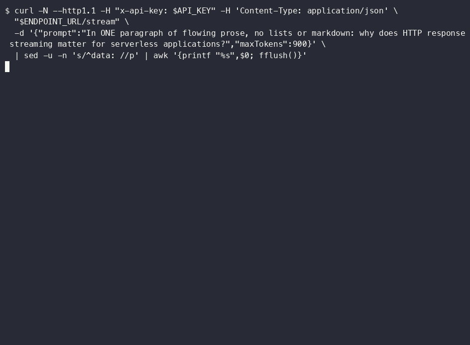

# streaming-bedrock-example-java

A deployable **Java** Lambda that relays Amazon Bedrock Nova Lite token deltas to the client as
Server-Sent Events, token by token, behind API Gateway REST, on the **managed** `java25` runtime,
with no Lambda layer, no custom runtime and no wrapper script.

It is the Java counterpart of [`streaming-bedrock-example`](../streaming-bedrock-example/README.md).
Its production sources are Java only, and it drives the published
[`streaming-sse`](../streaming-sse/README.md) library from Java source. That is the point: it shows
on a deployed endpoint that the streaming mechanism is not Kotlin-specific.

<p align="center">
  
</p>

<p align="center"><em>Demo recorded against the Kotlin example (<code>streaming-bedrock-example</code>). It was not recorded against this Java endpoint; the Java measurements are in the table below.</em></p>

## What it does

`POST /stream` with `{"prompt": "...", "maxTokens": 2000}` returns a `text/event-stream` whose
`data:` events appear as the model produces them, followed by a terminal `[DONE]` event.

```
PromptParser → BedrockStreamHandler → BedrockAsyncSource (Nova Lite, InvokeModelWithResponseStream)
                      │                         │ SDK (Netty) callback threads
                      │                         ▼
                      │                    DeltaBridge  (enqueue only)
                      ▼
          StreamingResponse.stream + SseWriter   (streaming-sse)
```

## Why it needs `streaming-sse`

The `OutputStream` a `RequestStreamHandler` receives on the managed JVM runtime is a
`java.io.ByteArrayOutputStream`. Everything written accumulates in memory and is posted only after
`handleRequest` returns, so nothing reaches the client mid-invocation, `flush()` included.

`StreamingResponse` posts the response itself, incrementally, as a chunked request to the Lambda
Runtime API, and hands the handler that live stream. A small Java agent stops AWS's invocation loop
from posting a duplicate response. SnapStart, the CRaC priming hook and warm reuse keep working. See
the [`streaming-sse` README](../streaming-sse/README.md) for the mechanism and its limitations.

## Packaging and the agent

The function's own fat jar is also the agent.

- The build produces `build/dist/bedrock-streaming-endpoint-java.jar` with
  `Premain-Class: nl.vintik.lambda.streaming.sse.StreamingAgent` on its manifest.
- The build also produces `build/dist/bedrock-streaming-endpoint-java.zip`, with the jar under
  `lib/`. The template's `CodeUri` is that **zip**, never the bare jar: Lambda extracts a bare jar
  loose into `/var/task`, which leaves no jar file for `-javaagent` to name. The build fails if the
  zip is missing or has no `lib/bedrock-streaming-endpoint-java.jar` entry.
- `JAVA_TOOL_OPTIONS` carries
  `-XX:+TieredCompilation -XX:TieredStopAtLevel=1 -javaagent:/var/task/lib/bedrock-streaming-endpoint-java.jar`.

> **A wrong `-javaagent` path is fatal, not a graceful degradation.** If the path does not resolve
> to a jar carrying a `Premain-Class`, the JVM aborts during startup
> (`Error opening zip file or JAR manifest missing`) and every invocation fails to initialise. The
> agent loading but failing to patch is a different failure: `isPatched()` stays false and
> `StreamingResponse` throws before writing anything, with a message naming the fix. There is no
> automatic fallback to buffering. See the
> [Dev_Log entry](../docs/log.md#review-pass-on-the-article-and-readmes-four-documented-behaviours-that-the-code-does-not-have)
> (items 3 and 4).

## Stack

- Java 25 on managed **`java25`**, **arm64**, stack `bedrock-streaming-endpoint-java`
- **API Gateway REST** proxy integration with `ResponseTransferMode: RESPONSE_STREAM`, REGIONAL
- **SnapStart** (`AutoPublishAlias: live`) + CRaC priming + tiered compilation
- Least-privilege IAM: only `bedrock:InvokeModelWithResponseStream`, only on the Nova Lite inference
  profile and its regional foundation-model copies. The model id comes from the `MODEL_ID`
  environment variable, set from the same template parameter that scopes IAM
- API-key auth with a per-API usage plan; bounded memory and timeout; no provisioned concurrency;
  log retention 14 to 30 days (default 14)

## Quick start

### Build and test

```bash
# Unit + property tests (no AWS, no Docker)
./gradlew :streaming-bedrock-example-java:test -PexcludeTags=integration

# Full build: tests, fat jar, zip, zip check (does not run the coverage gate)
./gradlew :streaming-bedrock-example-java:build -PexcludeTags=integration

# Coverage gate (80% line coverage), run explicitly
./gradlew :streaming-bedrock-example-java:jacocoTestCoverageVerification -PexcludeTags=integration

# Validate the SAM template
sam validate --template-file deployment/aws/sam-bedrock-java/template.yaml
```

### Deploy

One prerequisite, once per account and Region: the stage has an access log, and a REST API can only
write CloudWatch logs when the account's CloudWatch role is configured in the deploy Region.

```bash
aws apigateway get-account --region <region> --query cloudwatchRoleArn
```

If that comes back empty, create an IAM role trusted by `apigateway.amazonaws.com`, attach the
`AmazonAPIGatewayPushToCloudWatchLogs` managed policy, and set its ARN as the account's
`cloudwatchRoleArn` (API Gateway → Settings, or `aws apigateway update-account`). Without it the
deploy can fail on the stage, or succeed and write no access log.

```bash
./deployment/aws/sam-bedrock-java/deploy.sh
```

This builds the zip and deploys it. `sam build` is deliberately not run, because the `CodeUri` is a
prebuilt archive. Extra arguments are forwarded to `sam deploy` (for example `--guided`).

> **Watch out:** SAM's `AutoPublishAlias` publishes a new Lambda version only when the **code**
> changes. A config-only deploy updates `$LATEST` but leaves the `live` alias, which API Gateway
> invokes, on the previous version with the old environment. After changing only a parameter,
> confirm the alias version carries it.

### Resolve the URL and API key, then try it

```bash
STACK=bedrock-streaming-endpoint-java
URL=$(aws cloudformation describe-stacks --stack-name $STACK \
  --query "Stacks[0].Outputs[?OutputKey=='StreamingEndpointUrl'].OutputValue" --output text)
KEY_ID=$(aws cloudformation describe-stacks --stack-name $STACK \
  --query "Stacks[0].Outputs[?OutputKey=='ApiKeyId'].OutputValue" --output text)
KEY=$(aws apigateway get-api-key --api-key "$KEY_ID" --include-value --query value --output text)

curl -sN --http1.1 -H "x-api-key: $KEY" -H 'Content-Type: application/json' \
  "${URL}stream" -d '{"prompt":"Explain SSE in three sentences","maxTokens":500}' \
  | sed -n 's/^data: //p'
```

Do not paste or log `$KEY`.

### Post-deploy test (opt-in, cost-guarded)

The same script as the Kotlin example, pointed at this stack. It invokes a paid model, so it does
nothing unless `BEDROCK_TEST_ENABLED=true` is set.

```bash
STACK_NAME=bedrock-streaming-endpoint-java BEDROCK_TEST_ENABLED=true ./scripts/bedrock-streaming-test.sh
```

It asserts that real HTTP time-to-first-byte is a small fraction of total time, that tokens land in
several distinct time buckets, that bytes on the wire stay close to the answer's own size, and that
the terminal `[DONE]` event arrives. It also reports whether the deployed alias carries
`-javaagent`, so a buffered result is diagnosed rather than merely failed. In CI the Java leg runs
only when `run-bedrock-test` is set on **CD - Deploy On Demand**; a push never invokes the model.

### Teardown

```bash
sam delete --stack-name bedrock-streaming-endpoint-java --region <region>
```

This removes the stack's function, API, API key, usage plan and log groups. It does not touch the
account-level API Gateway CloudWatch role.

## Measured result (deployed endpoint)

**Cold start (measured from CloudWatch `REPORT` lines, eu-west-1, CD run window).** Both functions
are java25, arm64, 1024 MB with SnapStart.

| | This example | Kotlin example |
|---|---|---|
| Init Duration (snapshot creation, `INIT_REPORT`) | n=6: mean 4304 ms (4154 to 4432) | n=6: mean 1640 ms (1529 to 1768) |
| Restore Duration (cold request) | n=1: 663 ms | n=1: 660 ms (15 restores over all deploys: 283 to 791 ms) |
| Deployed package | 13,980,145 bytes | 12,114,140 bytes |

The sample sizes are small, and the two functions differ in more than the HTTP client (SDK, Netty
async client, `DeltaBridge`, `-javaagent`, priming code), so these figures describe the two examples,
not Netty alone. Init runs when the snapshot is taken, so it is not paid per request; a cold request
pays the restore. Details are in [`docs/log.md`](../docs/log.md) (task 13.2).

**Streaming behaviour (post-deploy test, CD run 44801738573).** One measured request per example,
sent after a discarded warm-up request, with `maxTokens=5000`.

| | This example | Kotlin example |
|---|---|---|
| Tokens received | 784 | 807 |
| Client time to first byte | 0.318 s | 0.390 s |
| Total time | 7.865 s | 7.514 s |
| TTFB as a fraction of total | 4.0% | 5.2% |
| Distinct time buckets with tokens | 15 | 14 |
| Bytes on the wire | 15,051 (about 1.7x the answer's own size) | 15,549 |
| Terminal `[DONE]` event | received | received |

These are single post-warm-up requests from one run, not benchmarks. Token counts differ because the
model's answers differ, so total time and byte counts are not comparable between the two columns
beyond showing that both stream. What the run shows is that the first byte arrives in a small
fraction of the total time and the tokens spread over many time buckets, so the response is not
buffered.

## How the Java port differs from the Kotlin example

| | Kotlin example | This example | Why |
|---|---|---|---|
| Bedrock client | Kotlin AWS SDK, response collected as a coroutine `Flow` on the invocation thread | `BedrockRuntimeAsyncClient` on the Netty NIO client | In the AWS SDK for Java v2, response streaming for Bedrock exists only on the async client. `BedrockRuntimeClient` has neither `invokeModelWithResponseStream` nor `converseStream` |
| Getting deltas to the writer | None needed | `DeltaBridge`: an unbounded `LinkedBlockingQueue` of `Delta`, `Done` and `Failed` signals | SDK callbacks run on Netty threads. They only enqueue, never write, never block and never throw (the SDK swallows exceptions thrown in a visitor). The invocation thread drains the queue and is the only writer, which keeps the non-thread-safe live stream and the thread-local `StreamingState` on one thread |
| Waiting for the model | Coroutine cancellation | A deadline of remaining invocation time minus 3 s | A stream that never completes or fails raises an explicit timeout on the invocation thread, after a best-effort SSE `error` event, instead of a silently truncated response |
| Response body | Kotlin lambda passed to `send` | `StreamingResponse.stream(requestId, metadata, ResponseBody)` with a Java lambda | A `fun interface` that declares `throws IOException`, with no `return null;` standing in for `Unit` |
| Response metadata | Default argument for `cookies` | `new ResponseMetadata(200, headers)` | Kotlin default arguments are invisible to Java. The two-argument constructor means the caller never passes `null` for `cookies`. `streaming-s3-example-java` still passes it explicitly |
| Parameter handling | Unsupported parameters are ignored | **Stricter:** any member other than `prompt` and `maxTokens`, and any non-JSON body, is rejected with 400 before the model is called | Predictable behaviour for a paid endpoint. The old padding knobs (`headPadBytes` and friends) are rejected too |
| Model id | Hard-coded in source | `MODEL_ID` environment variable | One parameter feeds both the id and the IAM scope, so they cannot drift |
| Coverage | Kover | JaCoCo, behind `koverVerify` / `koverHtmlReport` aliases | Kover cannot instrument a pure-Java module |
| After the stream opens | Handler still writes a 502 branch (see below) | No such branch | See below |

Tuning notes: the fat jar excludes both the `apache-client` and `apache5-client` modules, since this
module builds no synchronous HTTP client. The Netty cost in size and cold start is recorded in
[`docs/log.md`](../docs/log.md) (async client footprint entry) and is not restated here.

`SseWriter`'s methods carry no `@Throws(IOException::class)`, so Java cannot catch `IOException`
narrowly around them. The handler catches `Exception` for its best-effort error event. See the
[Dev_Log entry](../docs/log.md) on Java-from-Kotlin friction.

## Status ordering

A request that fails validation never reaches the streaming path. It is answered **400** on the
runtime's own buffered stream with no body bytes, and the model is not called.

Past that point the status is committed early. `StreamingResponse.send` (and so `stream`) writes the
metadata and the 8-byte delimiter **before** it runs the body, and the body is what calls Bedrock.
The **200 is on the wire before the model is invoked**, not when the first delta arrives. A model
failure cannot become a 502: the client gets a 200 whose body is truncated, or empty when the
failure lands before the first delta, ideally with a final SSE `error` event. The handler rethrows
so the invocation is reported as failed.

### Do not port the Kotlin 502 branch

The Kotlin handler contains a branch that writes a 502 after the stream has opened. The client can
never see it, and it is worse than useless: on that path the invocation is not marked answered, so
the handler returns normally and AWS's loop can post a second response for an invocation the
Runtime API has already accepted. That is the condition the Dev_Log records as producing
`Runtime.ExitError`, and it is **measured**, not inferred: against the deployed Kotlin stack a model
failure before the first delta gave the client an empty 200, and the invocation ended
`Runtime.ExitError` with about 60 s billed and the execution environment lost (the next request
restored a new one). See [the measurement](../docs/log.md#measured-the-kotlin-pre-first-delta-502-path-kills-the-execution-environment-runtimeexiterror). This module has no error path that tries to change the
status after the stream opens. Read the record before porting the Kotlin handler:
[`docs/log.md`, "Review pass on the article and READMEs", item 2](../docs/log.md#review-pass-on-the-article-and-readmes-four-documented-behaviours-that-the-code-does-not-have).

## Project structure

```
src/main/java/nl/vintik/streaming/bedrock/
├── BedrockStreamHandler.java   RequestStreamHandler; holds the static Priming; validates, then streams
├── PromptParser.java           API Gateway event or bare payload → PromptResult (strict, clamped)
├── PromptRequest.java          prompt + maxTokens
├── PromptResult.java           Resolved | Rejected(status, message)
├── PromptLimits.java           default prompt, token default and ceiling, prompt length cap
├── TokenStream.java            Source of deltas; DeltaSink.java is its consumer
├── BedrockAsyncSource.java     InvokeModelWithResponseStream on the async client
├── DeltaBridge.java            Callback threads → invocation thread, with deadline and cancel
├── NovaPayload.java            Nova request body and text-delta extraction
├── Deadline.java               Remaining invocation time minus a safety margin
├── Priming.java                CRaC beforeCheckpoint warm-up for SnapStart (no model call)
├── StreamTimings.java          Per-request timing lines, joinable to the API Gateway access log
└── ModelStream*Exception.java  Failure and timeout, unchecked
```

## Licence

MIT. See [LICENSE](../LICENSE).
