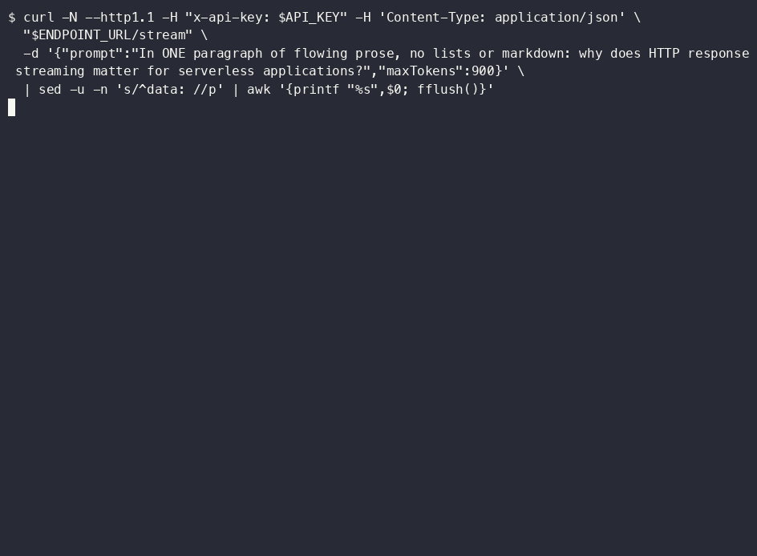

# streaming-bedrock-example

A deployable Kotlin Lambda that relays Amazon Bedrock Nova Lite token deltas to the client as
Server-Sent Events, **arriving token by token** — behind API Gateway REST, on the **managed**
`java25` runtime, with no Lambda layer, no custom runtime and no wrapper script.

<p align="center">
  
</p>

<p align="center"><em>This example, deployed: the first token lands 0.4 s in and the rest arrive over the following 4.7 s, while Nova Lite is still generating. <a href="../docs/bedrock-streaming-demo.mp4">MP4 version</a>.</em></p>

## What it does

`POST /stream` with `{"prompt": "...", "maxTokens": 2000}` and the response is a
`text/event-stream` whose `data:` events appear as the model produces them.

```
PromptResolver → BedrockStreamHandler → BedrockSource (Nova Lite, InvokeModelWithResponseStream)
                        │
                        └→ StreamingResponse + SseWriter   (streaming-sse)
```

## Why it needs `streaming-sse`

The `OutputStream` a `RequestStreamHandler` receives on the managed JVM runtime is a
`java.io.ByteArrayOutputStream`. Everything written accumulates in memory and is posted only after
`handleRequest` returns, so nothing can reach the client mid-invocation — `flush()` included, since
there is no connection behind the stream.

`StreamingResponse` posts the response itself, incrementally, as a chunked request to the Lambda
Runtime API, and hands the handler that live stream. A small Java agent stops AWS's invocation loop
from posting a duplicate response. SnapStart, the CRaC priming hook and warm reuse all keep working.
See the [`streaming-sse` README](../streaming-sse/README.md) for the mechanism and its limitations.

## Measured result (deployed endpoint, eu-west-1)

688 tokens, an 8,131-character answer, `maxTokens=2000`:

| | on the wire | client TTFB | as % of total | token spread |
|---|---|---|---|---|
| buffered handler stream | 14 KB | at the end | 100% | one burst |
| **this example** | **14 KB** | **0.199 s** | **2%** | 8.8 s (the generation) |

Server side: API Gateway had the response headers at 31 ms and the first content at 307 ms, with the
integration stream open for the full 9.3 s. `Max Memory Used` 145 MB, no invocation errors, CRaC
`beforeCheckpoint` firing. Raw numbers and method in [`docs/log.md`](../docs/log.md).

## Stack

- Kotlin on managed **`java25`**, **arm64**, 1024 MB
- **API Gateway REST** proxy integration with `ResponseTransferMode: RESPONSE_STREAM`, REGIONAL
- **SnapStart** (`AutoPublishAlias: live`) + CRaC priming + tiered compilation
- Deployment package is a **zip** carrying `lib/<fat jar>`, and `JAVA_TOOL_OPTIONS` carries
  `-javaagent:/var/task/lib/bedrock-streaming-endpoint.jar`
- Least-privilege IAM: only `bedrock:InvokeModelWithResponseStream`, only on the Nova Lite profile
- API-key auth with a per-API usage plan

## Quick start

### Build and test

```bash
# Unit + property tests (no AWS, no Docker)
./gradlew :streaming-bedrock-example:test -PexcludeTags=integration

# Coverage report + gate (80%)
./gradlew :streaming-bedrock-example:koverHtmlReport :streaming-bedrock-example:koverVerify

# Validate the SAM template
sam validate --template-file deployment/aws/sam-bedrock/template.yaml
```

### Deploy

One prerequisite, once per account and Region: the stage has an access log, and a REST API can only
write CloudWatch logs when the account's CloudWatch role is configured in the deploy Region.

```bash
aws apigateway get-account --region <region> --query cloudwatchRoleArn
```

If that comes back empty, create an IAM role trusted by `apigateway.amazonaws.com`, attach the
`AmazonAPIGatewayPushToCloudWatchLogs` managed policy, and set its ARN as the account's
`cloudwatchRoleArn` (API Gateway → Settings, or `aws apigateway update-account`). Without it the
deploy can fail on the stage, or succeed and write no access log.

```bash
./deployment/aws/sam-bedrock/deploy.sh
```

This builds `build/dist/bedrock-streaming-endpoint.zip` (fat jar under `lib/`, with `Premain-Class`
on its manifest so the same jar is the agent) and deploys it. `sam build` is deliberately not run —
the `CodeUri` is a prebuilt archive.

> **Watch out:** SAM's `AutoPublishAlias` publishes a new Lambda version only when the **code**
> changes. A config-only deploy updates `$LATEST` but leaves the `live` alias — which API Gateway
> invokes — on the previous version with the old environment. After changing only a parameter,
> confirm the alias version carries it.

### Try it

```bash
STACK=bedrock-streaming-endpoint
URL=$(aws cloudformation describe-stacks --stack-name $STACK \
  --query "Stacks[0].Outputs[?OutputKey=='StreamingEndpointUrl'].OutputValue" --output text)
KEY_ID=$(aws cloudformation describe-stacks --stack-name $STACK \
  --query "Stacks[0].Outputs[?OutputKey=='ApiKeyId'].OutputValue" --output text)
KEY=$(aws apigateway get-api-key --api-key "$KEY_ID" --include-value --query value --output text)

# Tokens appear as they are generated. No padding to strip.
curl -sN --http1.1 -H "x-api-key: $KEY" -H 'Content-Type: application/json' \
  "${URL}stream" -d '{"prompt":"Explain SSE in three sentences","maxTokens":500}' \
  | sed -n 's/^data: //p'
```

### Post-deploy test (opt-in, cost-guarded)

```bash
BEDROCK_TEST_ENABLED=true ./scripts/bedrock-streaming-test.sh
```

Four assertions, each guarding a failure seen during development: real HTTP time-to-first-byte must
be a small fraction of total time, tokens must land in several distinct time buckets, bytes on the
wire must stay close to the answer's own size (a padding-regression guard), and the terminal
`[DONE]` sentinel must arrive. It also reports whether the deployed alias actually has the
`-javaagent` flag, so a buffered result is diagnosed rather than merely failed.

## Project structure

```
src/main/kotlin/nl/vintik/lambda/bedrock/
├── BedrockStreamingHandler.kt  Lambda entrypoint; eagerly constructs Priming for SnapStart
├── BedrockStreamHandler.kt     Orchestration: resolve → stream SSE → status ordering
├── BedrockSource.kt            Nova Lite InvokeModelWithResponseStream (Kotlin AWS SDK)
├── PromptResolver.kt           API Gateway event → PromptRequest, with clamped bounds
├── PromptRequest.kt            prompt + maxTokens
├── Priming.kt                  CRaC beforeCheckpoint warm-up for SnapStart
├── StreamTimings.kt            Per-request timing lines, joinable to the API Gateway access log
└── NonFatal.kt                 runCatching that rethrows cancellation and JVM errors
```

## Status ordering

A request-resolution error never reaches the streaming path, so a bad request is answered **400** on
the runtime's buffered stream with no body bytes.

Past that point the status is committed early. `StreamingResponse.send` writes the metadata and the
8-byte delimiter before it runs the body, and the body is what calls Bedrock, so the **200 is on the
wire before the model is invoked**. A model failure cannot turn that into a 502: the client gets a
200 whose body is truncated, or empty when the failure lands before the first delta. The handler
still writes a 502 onto the runtime's buffered stream in that case, but the client has already been
given the 200, so it never sees it. After a delta has been relayed the handler rethrows, so the
invocation is reported as failed even though the client received a well-formed HTTP 200.

A successful generation with zero deltas returns 200 with just the terminal event.

## Licence

MIT. See [LICENSE](../LICENSE).
